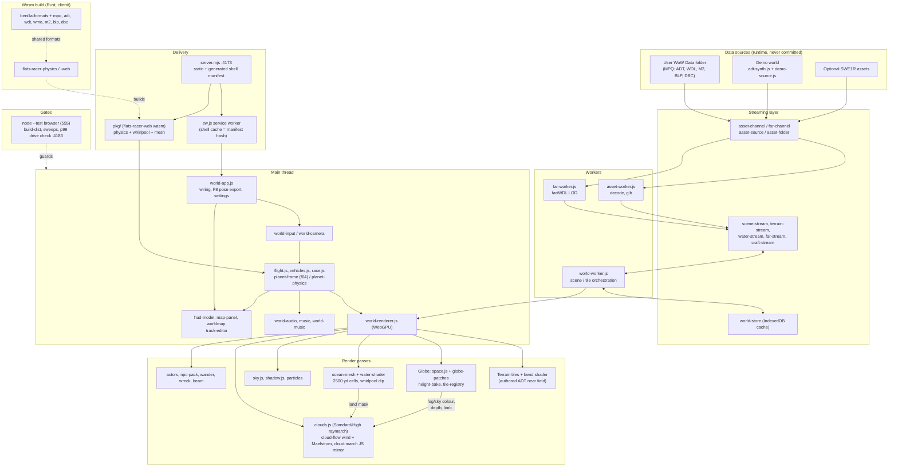

# Azeroth Racer: system architecture (current)

Single-player browser world over WoW 1.12 Kalimdor + Eastern Kingdoms, with a globe (planet R = 42,785 yd), driveable Rocket/podracers, and space.
WoW 1.12 data is required (no demo/no-data world: a missing Data folder shows "WoW data folder not found"); art and audio are never committed. Agents use the real data read-only via the parent checkout runtime\browser (never commit it).

## Notes
- **Frames:** world units are yards; flat tiles are bent onto the sphere by a shader (M5b, removing it, is deferred). The globe uses a coarse baked height texture (~130 yd/texel); authored ADT is only used near-field.
- **Handoff:** the flat ocean mesh hides above 25k yd and the globe sea takes over. Zone lighting fades to global sun lighting in space.
- **Night lights:** `night-lights.js` bakes a hand-written settlement table (warm firelight; Dalaran arcane, Karazhan eerie) into a 2048x1024 equirect texture once per world; `surface()` in `space.js` samples it on the dark side above ~2.5k yd. Demo worlds fall back to a few demo settlements. No per-frame cost beyond one texture read.
- **Files:** `shell-manifest.mjs` generates the shell list from the import graph (plus a small `RUNTIME_ASSETS` registry); `server.mjs` and `build-dist` serve/publish it and stamp it into `sw.js`, whose cache name is the manifest hash. No hand-edited list or version bump.
- **Removed material:** the VMaNGOS C++ server, native Bevy client crates, runtime/, tools/ and bootstrap scripts are no longer in the tree; see the root README for the commit that last contained them.
- **Next (rocket phase):** unified space physics per `SPACE-PHYSICS.md`; see `GLOBE-REFACTOR.md`, `CLOUD-FLOW.md`, `HARDENING.md`, `DEBT.md`.
- **Flight instruments:** `flight-hud.js` (right-edge compass, drum altimeter, climb rate) is fed once per frame from `app-frame.js` with the active framed body, `renderer.view` and sim time. `compass.js` converts the camera's chart basis to inertial space (`chartAxes`), picks the nearest body (`nearestSurface`) and returns the north-pole bearing and altitude, so one formula covers orbit, Elune and the E/N/S pole charts. `altimeter.js` holds the pure drum/climb model. The optional WoW ring texture and FRIZQT font come from the worker (`hud-art.js`, action `hud-art` -> event `hud-art`); images are drawn to canvas because the CSP blocks blob/data image URLs.

## Weather
See README 'Weather' and design/weather.md. Modules: weather-*.js plus renderer-weather.js (curtain, near particles, bolts, flash), stepped from stepWeather; audio via world-audio setWeather/thunder.

