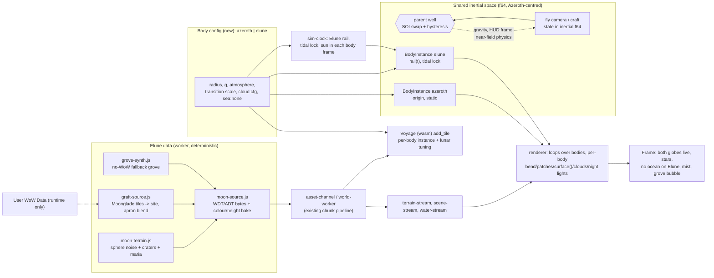

# Design: Elune, a drivable moon

Status: proposal (no code changed). Inputs read: `ARCHITECTURE.md`, `GLOBE-REFACTOR.md`, `SPACE-PHYSICS.md`, `design/{far-to-near,depth-culling,clouds,time,memory-budget,orbital-camera-controls}.md`, `space.js`, `regime.js`, `planet-frame.js`, `planet-physics.js`, `terrain-transition.js`, `globe-patches.js`, `tile-registry.js`, `height-bake.js`, `ocean-mesh.js`, `clouds.js`/`cloud-config.js`, `night-lights*.js`, `sim-clock.js`, `memory-budget.js`, `adt-synth.js`, `demo-source.js`, `loading-gate.js`, `world-music.js`, and `client/crates/flats-racer-web/src/{world,voyage}.rs`.

Goal (user): drive on Elune. A much smaller globe than Azeroth, same chunking and cloud approach, a procedural moon terrain generator instead of ocean, and one nature town on it made of duplicated Moonglade chunks (lake and trees included).

Revision (user, quoted): *"I do want both planets to exist in the same simulated physical space -- not just toggling which one we are on at the moment. We can have a 'which gravity well are we parented to' that swaps over at some point, to bound us to one, but planets should coexist as spheres of chunks."* and *"you can map teleport to the moon, sure -- but you can also fly there with the fly camera."*

## Summary of the approach
1. Make "the planet" a parameter (`Body`) instead of a module constant, and make **bodies live objects in one shared world space** (`BodyInstance`: config + position/orientation from the clock + its own far/near streaming, clouds, night lights, pipelines). Almost every planet function already takes `radius`/`centre`; the real work is the WGSL strings that bake `PLANET_RADIUS` and the transition ranges, and a renderer loop that draws N bodies.
2. Elune is a **second virtual map** (60 x 30 ADT tiles on the same 533.33 yd grid). A procedural generator emits **synthetic ADT bytes** exactly like `demoSource()`/`synthAdt()` already do. Render, collision, streaming, minimap, memory budget and wasm physics then run **unchanged**, and render/physics parity is free because both decode the same bytes.
3. Moonglade is **grafted** at tile granularity: real source ADTs are translated by an integer tile offset (no resampling), with a procedural apron that blends into the moon. With no WoW data, a procedural grove fills the same site.
4. **Both bodies coexist** as spheres of chunks in one inertial space (Azeroth at the origin, Elune on its analytic rail). Each body streams and renders itself at the LOD its distance/altitude asks for, so Elune is a real (coarse) globe from Azeroth and Azeroth a real globe from Elune: no impostor/active-body toggle. A **parent body (gravity well)** swaps at the Elune SOI with hysteresis; it chooses which gravity, frame, HUD/altitude and near-field physics apply, and never changes what is drawn.
5. Travel is **real flight**: the fly camera (free 3D, nearest-surface speed law, f64 pose) crosses the 250 kyd gap continuously and seamlessly through the parent swap; map teleport is the shortcut. Most of this is **JS-only**; the Rust changes are grouped into one batch.



---

## 1. World model

### Size and place
- **Radius R = 32000 / 2*pi = 5092.96 yd** (call it `ELUNE_RADIUS`). That is 1/8.4 of Azeroth (42,785 yd). Circumference is exactly **60 tiles** (32,000 yd) and pole to pole is 30 tiles, so the equirect chart tiles with no fractional wrap and fits the 64 x 64 WDT grid (`TILE = 1600/3`). Driving everywhere on the equator band loops in about 2 minutes at 270 yd/s, which feels like "a small world", yet it is as wide as one Azeroth continent.
- Orbit centre: reuse `MOONS[0]` (white moon, `orbit: 300000`), radius changed from 9000 to `ELUNE_RADIUS`. The decorative second moon is untouched.
- **Chart:** same equirect flat chart as Azeroth: `planetFrame/subPoint/globeToFlat/wrapFlat/gravityAt/circularSpeed/selectPatches` already accept `(centre, radius)`. Driveable band is **|lat| <= 55 deg**. East-west stretch is 1/cos(lat) = 1.74x at the edge. Beyond the band the chart is visible but a soft wall (or a "pole is too steep" bounce) keeps the craft out until a polar patch-only solution exists (non-goal).
- **Poles/chunks:** `MAX_LEVEL` for patches drops from 9 to 7 for Elune (level-7 cells ~4 yd, finer than the far bake needs).

### Clock coupling (`sim-clock.js`, `space.js`)
- Today `moonPlanetPosition` is decorative: `turns:1` is one orbit per `DAY_PERIOD` (24 real minutes), so the surface would move at ~1.3 kyd/s, un-chaseable. With `mu = g*R^2 = 1.96e10` the physical period at 300 kyd is `2*pi*sqrt(a^3/mu) = 7376 s` (about 5.1 Azeroth days). **Make Elune's rail physical: `ELUNE_PERIOD = 5 days` = 7200 s at 1x (`turns: 0.2`), speed ~262 yd/s.** That is slow enough to rendezvous with. Rails stay analytic (SPACE-PHYSICS rule); time warp 10-1000x keeps using `SimClock` and `rate`, and the rail is advanced analytically (a craft is "on rails" in free space under warp). **Warp is clamped to <= 10x whenever a craft/camera is inside a body's chart/near range** (below), because the near-field world does not warp.
- **Tidally locked:** Elune's rotation = its orbit, so Azeroth hangs at a fixed sky position for a surface point and the Moonglade site is chosen on the near side (lat 18 deg, lon 0), so Azeroth sits ~18 deg off zenith: huge (angular diameter 2*atan(42785/252000) = 19 deg, ~38x our Moon) and phase-lit.
- **Day length:** Sun relative to Elune's frame has synodic period `1/(1 - 1/5) = 1.25` Azeroth days = **30 real minutes at 1x** (15 min day, 15 min night). `daylightAt` is generalised to `daylightAt(t, body)` using the sun vector rotated into the Elune frame (sign and handedness covered by a unit test). The existing global `timeOfDay` stays the one source of truth; nothing new to persist.
- The sun stays a direction (`sunDirection(timeOfDay)`); on Elune it is expressed in body-local coordinates. Hard directional light and `shadow.js` cascades are unchanged.

### Travel Azeroth -> Elune
- **Regimes (`regime.js`):** make `regimeOf(altitude, body)` and the bands per body. Scale the altitude ranges (`BEND_RANGE`, `GLOBE_RANGE`, `SPACE_RANGE`, `ZONE_LIGHT_RANGE`) by **sqrt(R/R_azeroth) = 0.345** (a compromise: linear scaling by R would start bending at 18 yd, below a pod's height; no scaling would keep Azeroth's 150-1500 yd band, i.e. 3-30% of R. sqrt keeps both sane; tune in M0/M3). Elune: bend [52, 518] yd, space [690, 3100] yd; **no atmosphere regime** (`ATMOSPHERE_EDGE = 0`, `densityAt = 0`).
- **Regimes are per body.** Each body computes its own altitude (`|eye - centre| - R`) and `regimeOf(altitude, body)`. The same eye can be `ground` for one body and `orbit`/`space` for the other, and every body is drawn at its own transition weights (far weight 1, bend 0 for the distant one).

### Shared world space, bodies and the parent well
- **One inertial frame** (f64, Azeroth-centred, +Y up like the existing planet frame): Azeroth at the origin (static, non-rotating, per SPACE-PHYSICS); Elune at `p(t) = moonPlanetPosition(MOONS[0], t)` with a tidally locked orientation `Q_elune(t)` (rotation about its orbit normal, one turn per orbit). The sun is a direction only. `BodyInstance = {config, position(t), orientation(t), streams, cloud state, pipelines}`; `bodies.js` owns the list and the per-frame update `bodies.update(simTime)` (pure, testable).
- **Chart per body.** Each body keeps its own equirect chart (`planetFrame(x,z,centre,radius)`): surface positions, tiles, the HUD sub-point and the loading gate are all body-fixed. Conversions body-chart <-> inertial are `toInertial(body, pose)` / `fromInertial(body, p)` (rotate by `Q`, add `p(t)`), next to `planet-frame.js`.
- **Parent well (physics/HUD only).** `parent` is one of `azeroth | elune`. Gravity, the drag/atmosphere model, altitude/orbital-element readouts, near-field (flat-chart) physics and the chart pose are defined relative to the parent. The other body is a pure visual/target object for the craft (it never pulls it). **N-body is out of scope**: patched conics, which matches the rails-only test-particle model of `SPACE-PHYSICS.md`. See "Reconciling with SPACE-PHYSICS" below.
- **SOI swap with hysteresis.** Elune's sphere of influence `r_soi = a*(mu_e/mu_a)^0.4 = 300000 * (6.95e7/1.96e10)^0.4 ~ 31 kyd` (`mu = g*R^2`). **Enter Elune's well at `0.9*r_soi` (28 kyd), return to Azeroth's at `1.1*r_soi` (34 kyd)**, so jitter at the boundary cannot flap. A swap is also refused while any chart/near-field is active for the current parent (`altitude < SPACE_RANGE_top`, 9 kyd Azeroth, 3.1 kyd Elune), so the swap only ever happens in free 3D space.
- **Swap without a visual pop.** The craft/camera *state is stored inertially (f64 position, velocity, quaternion) at all times*, so a swap changes no stored number: it only retargets which body supplies gravity, HUD frame and chart. Rendering already works eye-relative against every body's inertial position, so there is nothing to rebase on screen. What does change at the swap is the **velocity reference** (relative to Azeroth vs relative to Elune differs by Elune's 262 yd/s). For the kinematic fly camera the commanded velocity is expressed in the parent's co-moving frame; the camera's frame velocity is **blended over ~3 s** (`frameVel = lerp(vOldParent, vNewParent, smoothstep(t))`), so Elune stops "sweeping past" smoothly instead of freezing. For a physical craft nothing is blended: it keeps its inertial velocity (continuity rule in `SPACE-PHYSICS.md`: no step in v or q) and the readout flips to Elune-relative. A test steps a craft and a camera through the swap both ways and asserts position, orientation and screen-space body positions are continuous.
- **Time-varying frames.** Azeroth's frame is inertial. Elune's is rotating (tidal lock, 1.45e-5 rad/s); the *chart* is body-fixed (so you stand still on the ground), but free-flight orientation is held as an inertial quaternion and converted to the body chart on chart entry, so no yaw jump appears as the camera descends.

### Travel Azeroth <-> Elune: teleport and flight
Both are first-class and v1 (no scripted cruise).
- **Map teleport:** `teleport({body, x, z, alt})` sets the parent, places the pose in that body's chart, shows the loading gate until the near tiles of *that* body are resident, and keeps the other body live (already streaming far data). Works the moment Elune's far data and near tiles generate.
- **Free flight with the fly camera:** the fly pose becomes a **3D free pose** above the chart regimes: `{parent, p:[x,y,z] f64 in the parent's inertial-aligned frame, q}` (`orient.js` quaternion), and chart pose below. Chart <-> free handoff at each body's `SPACE_RANGE` top with a hysteresis band (the existing `toPlanet/fromPlanet` do the maths; `FLIGHT.ceiling = 1e6` is removed or made per-body). No loading cut anywhere on the route: Elune's far bake/patches, night lights and clouds are streamed in the background from t=0; its **near tiles are prefetched on approach** from the predicted sub-point (see Streaming below).
- **Speed law by nearest surface (`flight.js`).** Today `flightBoost(altitude)` is a log-spaced 1x-40x smoothstep from 1 kyd to 1000 kyd of altitude above Azeroth, with horizontal speed `sqrt(boost)`; `walkSpeed 1200`, `fastSpeed 8000`. With two bodies the *altitude fed to the law is `min` over bodies of the surface distance*, with `boostFrom` and the span scaled per body (Elune `boostFrom = 1000 * 0.345`). Properties we want and test: (1) **C1 continuity** of speed in distance on ascent, cruise and descent; (2) exponential approach: speed ~ proportional to nearest-surface distance, so arriving at either body decelerates smoothly with no overshoot; (3) a cruise cap (`boostMax`) so the 252 kyd trip is ~25-45 s at walk, ~10 s with Shift, and a Shift+wheel multiplier for more; (4) the cap in the vertical (radial) axis only uses `sqrt` boost horizontally so lateral aim near a surface stays controllable. Time budget check in tests: ascent from the surface to 60 kyd, coast, and descent to 100 yd above Elune with no step in `|dv|/dt` greater than the law's own derivative.
- **Moving target.** Elune moves at 262 yd/s relative to Azeroth, trivial against fly speeds (kyd/s) but felt at low speed in the same frame. Hence "commanded velocity is in the parent's co-moving frame". A HUD target chip shows distance, closing speed and Elune's bearing from Azeroth; the map panel can "set target".
- **Precision at inter-body distances (floating origin, depth):**
  - Positions are f64 everywhere on the CPU (position ~3e5 has ulp 6e-11 yd). The GPU never sees absolute positions: per body the CPU computes `centre - eye` in f64 and casts to f32 (at 250 kyd the f32 ulp is 0.016 yd, which is sub-pixel at that distance), and the view matrix has zero translation. Near-field tiles and meshes stay relative to the eye exactly as now.
  - Per body the eye is also expressed in the *body-centred* frame and fed to `bendRel`/patch shaders (already how Azeroth works), so surface vertices at |v| ~ 43 kyd keep millimetre precision while within a few kyd of the camera, and the far side is never visible.
  - **Depth:** one depth range cannot cover 0.1 yd to 300 kyd in 24 bits. Plan: **reversed-Z, float32 depth, infinite far plane**, `near = clamp(1e-3 * distToNearestSurface, 0.1, 50)`, which gives sub-0.1 yd resolution at 1 kyd and a few yd at 250 kyd (right for distant globes). Fallback if reversed-Z lands late: **two layers** - a far layer (`[nearBodyRange, 1e6]`, drawn first, no skybox depth sharing) then a depth clear, then the near layer (`[0.1, ~60 kyd]`). A body goes in the near layer if its nearest surface is < ~20 kyd (Azeroth from the surface/orbit, Elune on approach), otherwise in the far layer. Bodies are never split across layers while the camera is within them (the existing globe path keeps its behaviour). `GLOBE_DEPTH_DROP` scales per body.
  - Fog/limb/sun disc/stars are camera-direction effects and need no range.
- **Streaming for two bodies (see also memory):** each `BodyInstance` has a `StreamPolicy` that maps eye distance/altitude to desired data: *far* (bake + patches, always), *mid* (L1 tiles) when altitude < ~3 kyd (Elune) / 9 kyd (Azeroth), *near* (L0 ADT, collision) when altitude < bend top. For descent the policy prefetches near tiles around the **predicted sub-point** (position + velocity over ~5 s, from the inertial state) once altitude < 2x the bend top, so by the time the chart engages the ring is resident; if not (e.g. teleport), the gate waits.
- **Elune from Azeroth** (surface or orbit) is the real Elune: from the ground it is 1.9 deg wide (the old white moon but with maria and craters visible from the far bake, terminator and Earth-shine), phase-lit by the same sun, correctly occluding stars. **Azeroth from Elune** is the real Azeroth at the far LOD (patches + bake + clouds), 19 deg wide.

### Reconciling with `SPACE-PHYSICS.md` (rocket phase)
- *Bodies:* the doc already says "Azeroth static at origin, moons on analytic rails". Amendment: Elune's rail gets the physical 5-day period and tidal-lock orientation above; the second moon is unchanged (visual only, no gravity).
- *Force model:* the doc currently says test particles integrate under "gravity from Azeroth plus moons (sum of point masses)". **Amend to patched conics by default**: a craft feels only its parent well; the parent swaps at the SOI exactly as above; **n-body (sum of wells) stays an optional later mode** (needed only for free-return/low-energy transfers) and is out of scope here. This keeps the integrator, prediction line and determinism tests as written; the prediction line just also reports "SOI entry/exit" events.
- *Handoff and frames:* its "continuity rule" (state transferred in the inertial frame, chart change is a rotation of the local frame) is exactly the swap rule used here; Elune adds a **second chart** and a time-varying body frame. Its phase 6 "Moon surface + landing frame" becomes mostly the chart of this design.
- *H_flat:* the doc fixes `H_flat ~ 500 yd`, `H_edge ~ 6 kyd` for Azeroth; these become per-body (`bend`, `atmosphere edge`), Elune's `H_edge = 0` (airless). Drag is `0` there.
- *Phasing (what is needed from rocket work):* the fly camera does **not** wait for it. Fly-camera flight needs only M0 + the free-pose/speed-law work below. Thrust/Hohmann transfers, prediction lines and SAS (SPACE-PHYSICS phases 1-5) become an **upgrade** of the same route and reuse the same frames and SOI. Elune surfaces (landing contact in the flat solver) need Rust batch M10 anyway.

### Gravity and physics scale
- Surface gravity: **g_elune = 0.25 * g_azeroth = 2.68 yd/s^2** (see open question 4). Circular speed at the surface `sqrt(gR) = 117 yd/s`; escape `165 yd/s`. Low gravity gives big, readable jumps and lets pods fly ballistic arcs; it also means a pod above ~117 yd/s on a *true* sphere would skip, so physics must stay on the **flat chart** (below).
- **Horizon:** at eye height h the horizon is `sqrt(2*R*h)`: 3 yd -> 175 yd, 10 yd -> 320 yd, 100 yd -> 1.0 kyd, 500 yd -> 2.3 kyd. Ground-level views end almost immediately, so the near ring only has to reach the horizon at the highest relevant altitude (about 3 tiles). This is the strongest simplification: **`nearRadius` shrinks, `TILE_CAP_MIN` (8) is enough** and `globe-patches` `cull:true` removes everything past the horizon (design/depth-culling.md).
- **Flat-chart physics (recommended):** as on Azeroth, the craft is simulated in the flat chart (gravity `-Y`, local g) and the bend shader only curves the picture. With R = 5093 the error vs a true sphere is `d^2/2R`: 1.2 yd at 110 yd, 28 yd at 533 yd. That is invisible because ground and craft are bent together; it only matters for long ballistic arcs. Add a tuning term `g_eff = g - k*v_h^2/R` with `k in [0, 1]` (default 0.5) so fast pods get floaty lunar skips instead of hitting orbital speed on a flat plane. Real orbital integration begins above the SPACE_RANGE band (SPACE-PHYSICS orbital integrator, `gravityAt(alt, radius)`).
- **Up vector:** chart Y == radial up everywhere; `localAxes(pose, centre, radius)` gives east/up/south. The camera up for orbital mode uses the same function.
- **Floating origin on a small sphere:** it is easier than Azeroth. All surface coordinates are <= 16 kyd (f32 ulp 1e-3 yd), the GPU already receives eye-relative positions, and the planet frame is f64. The only new hazard is chart stretch at high |lat| (above) and the **antimeridian wrap** every 32 kyd: tile index arithmetic uses `wrapFlat` and the existing wrap delta in `spaceHud`, which now has to use the body circumference instead of the hard-coded `2*pi*PLANET_RADIUS`.

---

## 2. Terrain: the procedural moon chunk generator

**Module:** `moon-terrain.js` (pure functions, no DOM, runs in a worker and in `node --test`).

### Function of the sphere, not of the tile
`height(seed, dir)` and `albedo(seed, dir)` take a **unit vector** (from lat/lon of the vertex). Tile coordinates only choose the lattice of vertices to evaluate. Consequences: adjacent tiles are watertight by construction, there is no seam at the antimeridian or pole pinch, and `(seed, tx, ty, lod)` fully determines the output.

### Height model (yards)
```
h = base(dir)                     // continental swell: 3D simplex-like fBm, wavelength 3000-8000 yd, +-60
  + highland(dir) * rough(dir)    // 6-octave fBm, 40-1200 yd, amplitude 25
  + maria(dir)    * flatten       // low-freq mask; inside maria roughness *0.15, albedo darker, level -35
  + craters(dir)                  // layered cell craters (below)
  + wrinkle(dir)                  // thin ridges in maria (ridged noise, +-3 yd)
  + regolith(dir)                 // 2-12 yd bumpiness, 4 octaves, collision-relevant "rumble"
```
- **Craters:** for octave k with cell size `c_k = [2200, 700, 220, 70, 24] yd`, 3D cell grid on the sphere; per cell a hashed centre (jittered), radius `r in [0.15c, 0.45c]`, age. Profile per crater: `bowl = -d*(1-(u)^2)` for `u = dist/r < 1`; rim `+0.15d * exp(-((u-1)/0.15)^2)`; ejecta `+0.05d*(1/u)^3` for `u > 1`; central peak for `r > 300 yd`. Old craters are softened by `age` and by overlapping newer ones (smooth-max). Depth/diameter 0.2 (fresh) -> 0.05 (old). Only the 3 largest octaves exist at far LOD; the 2 smallest (<= 70 yd) matter for driving and only exist in the ADT tiles.
- **Determinism:** integer hashing (`imul` based, 32-bit) and polynomial smoothstep, **no `Math.sin`/`cos`/`pow` in the hot path** so results do not depend on the JS engine's libm. The test suite holds golden hashes (`height` at 64 points, tile checksum for 6 tiles) so a refactor cannot change the moon silently.
- **Albedo/colour (RGB + roughness):** highlands 0.45 grey-warm; maria 0.16 blue-grey; regolith slope darkening (steeper = exposed, brighter); fresh crater rays and ejecta bright (0.7) decaying with age; tiny noise-driven colour variation. Elune is **white-silver with a hint of lavender** (art direction: not photorealistic grey, "Elune's light"): maria tint `[0.55,0.58,0.72]`, highlands `[0.82,0.82,0.86]`.

### Chunk format and size
- **Chunk = one ADT tile**, 533.33 yd, 16 x 16 MCNK of 33.33 yd, 145 verts each (outer spacing 4.17 yd). We keep this (`ADT_TILE`, `ADT_CHUNK`, `TILE = 1600/3` in `voyage.rs`, `MAX_RESIDENT = 32`) so *zero* streaming/collision/Rust changes are needed. The generator writes MCVT heights (and a 256 x 256 RGBA colour texture + optional shader detail) into a `synthAdt`-compatible byte buffer.
- **Texture:** `TERRAIN_TEXTURE_SIZE = 256` per tile (2.08 yd/texel) holds albedo. Close-range grit comes from a **world-space procedural detail** in the terrain shader (two noise bands, 0.2-6 yd, faded by distance, tinted by the tile albedo) so no BLP assets are needed on the moon. The synthetic ADT therefore skips texture layers; a flag on the tile selects the "moon" shading path rather than the splat path.

### LOD
| Level | Use | Source | Spacing |
|---|---|---|---|
| L0 | within ~3 tiles of the player | synthetic ADT (resident, collision) | 4.17 yd |
| L1 | mid ring if the player is above ~300 yd | same generator, stride-2 decimated mesh | 8.3 yd |
| L2 | beyond the horizon / orbit | globe patches + baked height texture | 8 - 16 yd/texel |
- Far data: `height-bake` becomes body-aware: **2048 x 1024, R16** for Elune (31.4 kyd / 2048 = **15.3 yd/texel**, vs Azeroth's ~130 yd). That is already finer than the largest 3 crater octaves, so M5b ("authored height too fine for the bake") is not a blocker on Elune and the moon is a natural testbed for the unified patch tree's native-sphere near leaves (`far-to-near.md` migration step 3).
- The bake is computed progressively in the far-worker (about 2.1 M samples of the 3-octave far model at ~1.5 us = 3 s; spread over idle frames), cached in `world-store` (IndexedDB) under key `elune:{seed}:{genVersion}`. Colour bake `1024 x 512` (`bakeSurface`-like) for the globe and the map panel.

### JS vs wasm, workers
- **Start in JS** (worker): per tile 37k vertices x ~6 fBm octaves + 5 crater octaves x 27 neighbour cells ~ 12-25 ms. Budget: one tile per frame in `far-worker`/a new `moon-worker` role (design/workers.md; 4 concurrent tile generations max), cancellable on eviction, request deduplicated by `(tx,ty,lod,genVersion)`.
- **Move to Rust only if** (a) p99 tile time > ~40 ms on the target device, or (b) cross-engine float differences appear. The Rust version is a straight port (same integer hash, same crater table) in a `flats-racer-physics` module shared with `Voyage` so physics could query exact heights between tiles. It is placed in the Rust batch (M10) as optional.
- **Collision parity:** the physics reads the same ADT bytes through `Voyage::add_tile(index, bytes)`, so the collision mesh equals the rendered mesh at L0. The L1 mesh is visual only (outside collision radius). Parity test: generate tile, decode with the JS ADT reader and the wasm path, compare `sample(p)` on a lattice (the Rust side exists; the check lives in JS tests with a built `pkg/` when available, otherwise skipped).
- **Per-body physics:** each body has its own **`Voyage`** built from the body's manifest (`Voyage::new(json)`), with lunar `tuning()` (gravity, no drag, hover height). Only the **parent's** `Voyage` is stepped and fed physics frames; the other keeps its resident collision tiles idle (or released, see memory). A parent swap happens only in free space, so no contact state needs to move between the two. Residency per `Voyage` stays `MAX_RESIDENT = 32`.

### Memory budget integration (`memory-budget.js`)
- `splitBudget` shares are unchanged (scene 40%, far 15%, terrain 20%) but are now **partitioned among resident bodies**, since both stay live. Always-resident per body ("far set"): Azeroth far bake + colour + night bake (existing, ~12 MiB), Elune far bake 4 MiB (R16 2048x1024), colour 2 MiB, night 2 MiB (1024x512), tile registry, patch state: **Elune adds ~8-10 MiB of far data; the far share (15%) easily holds both** (at the 192 MiB floor it is 28 MiB: tight, so Elune's far set is the first thing downgraded to 1024x512 bakes under `BUDGET_FLOOR`).
- **Near sets are demand-driven, not per-body:** the near ring is only resident for a body whose altitude is below its bend top, which in practice is the parent only. `TerrainStream`/`SceneStream` caps (`residentTileCap`, `SCENE_LIMITS`) are one shared pool keyed by `(body, tile)`; eviction scores weight distance in *body-local* terms and demote the non-parent body first. After leaving the ground, the old body's near ring is **kept for a grace period (60 s) at <= 8 tiles** (`TILE_CAP_MIN`) so a quick return is instant, then dropped to zero; the new body's prefetch ring (<= 9 tiles for Elune thanks to the 175-700 yd horizon) is admitted before the old one is evicted, so peak near memory = old grace ring + new ring ~ 17 tiles, within the 32-tile cap. Moonglade's scene set lives in the same scene budget while Elune is parent.
- **Cloud/GPU budget:** each cloud shell is scissored to its body's projected bounding sphere and rendered at body-dependent tier/resolution; the body that is not the parent is forced to the Standard tier and half resolution when it covers < ~15% of the screen (Elune from Azeroth: ~0.1%, effectively free; Azeroth from Elune: ~4% of the frame). `gpuBytesOf` counts both bodies' textures.
- `memoryUsage` reports per-body rows (far/near/scene) in Diagnostics so the two-body split is observable. Total new resident cost with both live and Elune as parent: **<= ~25 MiB far + <= ~17 near tiles**, comparable to today's Azeroth-only peak.

---

## 3. Rendering

### Reuse
- **Bend shader / terrain tiles / globe patches / far-to-near transition:** reused. `terrain-transition.js` takes `(altitude, body)` and returns the same `TransitionUniforms` (it already returns fixed ramps, only the ranges scale). `space.js` shaders are currently generated from top-level constants (`const R = ${PLANET_RADIUS}.0`, `DEPTH_R = R - GLOBE_DEPTH_DROP`). **Prerequisite refactor (milestone 0):** `spaceShader(body)`/`patchShader(body)`/`cloudShader(body)` become generators called per body, producing **one pipeline per body, both live** (created at startup or lazily on first visibility; Elune's is small). The frame loop iterates bodies far-to-near (by eye distance), each with its own uniform block (centre-minus-eye, orientation, radius, sun in body frame, transition weights, patch list), sharing the depth/colour targets (depth layers per the precision section). `MAX_PATCHES` (768) is a frame-wide pool split by projected area (Azeroth ~512, Elune ~128-256; a body below a pixel threshold gets level-2 patches or a single textured sphere draw). Behaviour for Azeroth must remain bit-identical when Elune is far (golden shader-string test and the existing 555 tests).
- `GLOBE_DEPTH_DROP` (400 yd on Azeroth) scales with the body (~120 yd) so the globe sphere stays behind the bent terrain (design/depth-culling.md).
- **Ocean path off:** `ocean-mesh`, `water-shader` global plane, `OCEAN`/`isDeepOcean`, whirlpool dip, and the cloud shader's "land mask" are not instantiated for Elune (`body.sea = null`). `tile-registry`'s `proceduralProvider({water:false})` already does this. The local lake uses the per-tile water pass (section 4).

### Surface shading (`moonSurface()`)
New WGSL branch used by both near tiles and patches:
- Lambert from the hard sun, **no atmosphere scattering/fog** (lunar) except inside the grove bubble.
- **Earthshine fill:** a cool blue fill from the Azeroth direction, intensity = Azeroth phase x 0.06; this makes the dark side readable without breaking the "night" feel. Azeroth is at a fixed sky position so this is one uniform.
- Opposition surge / roughness: a cheap retro-reflective term (brighter when the sun is behind the camera) sells regolith.
- Slope-dependent albedo + detail noise as above. Specular none.
- **Shadows:** keep `shadow.js` cascades; the low sun and no atmosphere yield long black shadows, so ambient floor ~ 0.03 + earthshine. Cascade distances scale with the shorter horizon.

### Sky
- **Airless:** `planetFactors(altitude, enabled)` already has an `enabled` argument; for Elune the atmosphere factor is 0 so stars and sun disc are always visible, sky is black. The daylight terminator is a pure surface lighting effect.
- **Stars:** unchanged texture/pass, brighter (no extinction). **Both globes are real bodies, not impostors:** Azeroth seen from Elune (19 deg) is the normal Azeroth globe path (patches + colour/height bake, ocean specular, cloud shell, atmosphere limb glow) at the far LOD, correctly lit by the sun (phases), occluding stars; Elune seen from Azeroth uses the Elune pipeline at its far LOD (bake + level-2/3 patches; 1.9 deg, a few hundred pixels at most), replacing the old flat tinted sphere in `MOONS[0]`. Bodies occlude each other and cast no shadows on each other (eclipses: a cheap analytic sun-disc occlusion term in `moonSurface()` and the globe shader is a later nicety). The second moon stays a simple sphere.
- **Grove bubble (fantasy exception, see 4):** the grove has a local breathable atmosphere. `atmosphereFactor = bubble(distance to grove centre)`: 1 inside ~700 yd, smoothstep to 0 by ~1400 yd. It drives sky colour, fog, ambient and sound. The edge is shown as a faint silver-blue shimmering veil (a thin `shell` in the cloud pass with low density and an aurora-like gradient), which also hides the transition. Cheap fallback: no veil, just the factor.

### Clouds
- **Approach:** reuse `clouds.js` raymarch/curved-shell unchanged, with a per-body `CloudBody` config: `{radius, altitude, thickness, halfSize, coverage, tint, wind, features}`. `cloudUniform` stops reading `PLANET_RADIUS`/`HYJAL_SUMMIT` directly, and `cloudShellRadius(altitude, planetRadius)` already takes the radius. `CLOUD_RADIUS_GROUND_SCALE` (shell tightening near the ground) is kept.
- **Is Elune cloudy?** What looks good: **no weather clouds on the bare moon.** Instead:
  1. **Silver mist sheets** in crater floors/low basins at night (ground fog, 30-60 yd thick, coverage from `-height` and darkness), thin, slow, backlit by Azeroth: "ethereal moon mist".
  2. **Grove microclimate (decided):** the breathable bubble owns a small local cloud cluster over and around it, drawn by the same curved-shell cloud system (CloudBody for Elune). Coverage is driven by the **same bubble mask** that drives sky/fog/ambient (ubble(dist to grove centre): 1 inside ~700 yd, 0 by ~1400 yd), times a noise cluster so it reads as a few soft cumuli and wisps, not a uniform sheet; the cluster shell sits at ~180 yd, drifts slowly with a body-local wind, and is **exactly zero elsewhere on the moon** (the mask is the only coverage source, so there is no weather outside the bubble). The mask is one shared function (ubbleMask(pos, site)) used by the shader uniforms, the JS cloud-march mirror and sound, so they cannot disagree.
  3. High, sparse wisps (coverage 0.1) elsewhere only as a possible later art pass.
- Config (Elune): `altitude 180 yd, thickness 70 yd, halfSize 30 kyd -> one 32 kyd wrap`, `tier` unchanged (Standard/High), tint `[0.85,0.88,1.0]`, `features: {maelstrom:false, funnel:false}`, wind 1/4 of Azeroth. The Azeroth shell (altitude 1577 yd = 31% of R) cannot be reused: it must scale with the body.
- `CloudClock`/`cloud-flow.js` are unchanged except their domain wrap for the smaller circumference (fix the hard-coded `CLOUD_HALF_SIZE = 250000`).

### Night lights and limb
- `night-lights.js` bakes settlements into a 2048 x 1024 equirect. Elune gets its own bake with the Moonglade settlement (warm fire, `FIRE`, plus a cool "moonwell" palette: add a `moon` palette entry, `FLAG_ARCANE`), visible from orbit/approach on the night side. `settlementLights` is unchanged; add `body` to `settlementPositions`.
- **Limb:** `horizonDip(altitude, bend, radius)` already takes the radius. Limb glow on Elune is a very thin cold rim (none for the airless body except near the grove); Azeroth in the sky gets the standard atmosphere rim.

---

## 4. The nature town: Moonglade graft

### Concept
"Duplicate chunks of Moonglade": the Kalimdor Moonglade tiles are **read at runtime from the user's local WoW data** and re-emitted as Elune tiles with integer tile translation. The Kalimdor originals are untouched. Nothing from WoW data is ever written to the repo or hosted shell.

### Where chunks come from and the manifest
- A tiny hand-authored **site manifest** (committed, no game data): `elune-sites.json`
```json
{ "moonglade": {
    "source": { "map": "Kalimdor", "area": 493, "tiles": "auto" },
    "dest":   { "tx": 28, "ty": 12 },
    "yOffset": "auto",
    "apron": 1, "bubbleRadius": 700,
    "lake": "auto", "fallback": "grove-synth" } }
```
- `source.tiles: "auto"`: scan the source map's ADT MCNK `area_id == 493` (AreaTable "Moonglade"; `benilla-extract scan/world.rs` already scans these), take the bounding tiles (about 2 x 2). The result is cached in `world-store` and keyed by the WoW build hash, so the scan runs once.
- `dest`: tile indices on the Elune chart at lat ~ 18 deg, lon ~ 0 (near side). Translation is `delta = (dest - src) * 533.33` in x and z. No rotation or resample, so heights, splats, water and placements are exactly aligned.

### Reading and emitting (`graft-source.js`, worker)
For each source tile `(sx, sy)`:
1. Fetch via the existing source stack (`asset-source`/`asset-folder`/`asset-channel`, same loader that feeds `world-worker`): terrain ADT + `_obj0` (doodads MDDF, WMOs MODF) as today.
2. **Terrain:** copy MCNK heights (MCVT), alpha splats, texture layers (BLP names resolve through the normal texture path), shadow/vertex colours. Rewrite header tile indices (and MCNK x/y position fields) to the destination tile; add `yOffset`.
3. **yOffset:** chosen so the *mean height of the graft's outer-ring chunks* equals the procedural height at the site (`mean(proc(boundary))`), so the grove sits in a self-consistent basin; the apron then closes the small residual. Moonglade is already a bowl, which the generator reinforces by carving a **caldera**: `proc(dir)` receives a `siteMask` that lifts the rim to the surrounding procedural level over ~1.2 kyd (a "hidden valley in a crater").
4. **Water:** Moonglade water is liquid data in the MCNK/MH2O block (Lake Elune'ara). It is copied with `yOffset` and flows through `water-stream`/`set_scene_water` exactly like an Azeroth inland lake: a **local water plane**, not an ocean. `body.sea = null` guarantees no global sea level will fill basins on Elune.
5. **Scene:** MDDF/MODF placements `(pos + delta + yOffset, rot, scale)` are written to the scene pack consumed by `scene-stream` (`placementMatrix`, `globalCollisionVertices`). Trees, nighthaven buildings, Remulos shrine WMOs and their collision come along. They obey the scene budget (`SCENE_LIMITS`), so the 40% scene share is where Moonglade's cost lands.
6. **Bend:** doodads/WMOs are flat chart objects bent like Azeroth's, curvature over a 1.6 kyd site: `d^2/2R = 63 yd` at the far edge. Acceptable for terrain; for rigid WMOs (shrines) bend is applied per instance at its origin (existing path). Gate on a visual check in M9.

### Blending into procedural terrain (apron)
- **Heights:** the apron is the ring of tiles around the graft (width 1 tile = 533 yd). Apron tile generator evaluates `h = lerp(graftEdge(x,z), proc(dir), s)` where `graftEdge` samples the nearest graft chunk edge (clamped extrapolation) and `s = smoothstep(0, 1, d / apronWidth)`. At `d = 0`, `s = 0`, so the apron equals the graft edge height; ADT neighbours already share exact edge vertices, so there is no crack. Beyond the apron it is pure moon.
- **Colour:** apron albedo = `lerp(graftEdgeColour, regolith, s)` with a lichen/moss noise that fades with `s`, so grass thins into silver dust over ~500 yd.
- **Skirts:** the graft is whole-tile, so no partial-tile skirts exist. A small stitching pass copies the apron's graft-facing edge heights and normals from the graft's boundary row so lighting is continuous.

### Zones, NPCs, music
- **Area:** `world.area_at()` reads MCNK area ids; graft tiles keep `493`, apron/other moon tiles use synthetic ids `>= 90000` (`90001` "Elune highlands", `90002` "Mare Lunare", `90003` "Moonglade Reach" for the apron). A small JS **area overlay** (`custom-areas.js`: id -> name, music zone, light params) supplements `AreaTable` lookups for ids missing from the DBC. If the wasm `area_at` ignores unknown ids it gets handled in the Rust batch.
- **Names and HUD:** `placeName`/`nearestLandmark` get a per-body table.
- **Music:** `world-music.js` resolves area -> `ZoneMusic` row. 493 resolves to the real Moonglade tracks when data is present. Overlay entries on Elune either point to an existing quiet row (Moonglade night track) or to nothing (silence + ambient), with a distinct "vacuum" ambience. Without data, `music.js` already falls back to silence.
- **NPCs:** `npc-pack` entries whose spawn tile lies in the source set are translated with the same `delta`, so Moonglade's NPCs (Nighthaven inhabitants, Remulos, wanderers) appear. `validatePopulation` runs on the translated pack. *Unknown:* whether the NPC pack is a prebuilt extract artifact; if so a graft filter runs at extract time (Rust, batch) rather than at load.
- **Collision:** unchanged: terrain via `add_tile`, WMOs/doodads via `set_scene_mesh`/`set_scene_parts`, water via `set_scene_water`.

### Loading gate
`loading-gate.js` (`NEAR_CHUNKS = 4`, timeout 15 s) is extended with `required: [site tiles]` when the spawn is inside the bubble: the gate waits until the graft tile + its apron + ~10 scene instances are resident, with the same time-out fallback. **If a graft tile fails to load, the site degrades to the procedural grove at the same site, never to a hole.**

### Without WoW data: procedural grove (`grove-synth.js`)
Same site, same bubble, same lake position:
- Terrain: caldera basin from the generator; flat-ish meadow, moss (green/teal splat colour), lake basin carved in (radial `-12 yd` bowl + noise).
- Lake: single water quad with level = rim - 3 yd through the same water path.
- Trees: instanced low-poly procedural trees (`glb.js`-style generated meshes, 3 species, ~300 instances by Poisson-disc, hash-seeded), each with a trunk collider (capsule) in the scene pack; a few moonwell/glow stones; fireflies from `particles.js`.
- This is also the **test fixture** for the graft (same manifest shape, same `required` tiles), so CI never needs game data.

---

## 5. Racing and gameplay
- **Pods:** the same hover racers with a "lunar" tuning profile: `g = 2.68`, no aerodynamic drag, `k = 0.5` curvature relief, higher hover clearance, stronger lateral grip (regolith). `vehicle-model.js`/`vehicles.js` already take tuning; `Voyage::set_tuning(...)` supplies gravity. Top speed unchanged initially; cap to ~110 yd/s without lunar skip, or let `k` absorb it (open question 4).
- **Tracks:** `race-gates.js`/`track-normalize.js` already normalise tracks by world. Add `tracks/elune/*.json` per body (committed, no game data): (1) "Grove Loop" (through the bubble, around the lake: needs graft or fallback), (2) "Crater Rim" (follows a large crater, ~6 kyd), (3) "Mare Run" (flat maria sprint, ~12 kyd). Gates snap to terrain height at load via the heightfield. The existing track editor works with the body selector.
- **Map/teleport:** `map-panel.js`/`worldmap.js` get a **body tab** (Azeroth | Elune). The Elune map is the colour bake (1024 x 512 equirect) with POIs: Moonglade site, launch pad(s), track starts. `teleport(to: {body, x, z})` sets the parent, shows the loading gate until that body's near ring is resident and respawns at the point (the same gate as flight arrival when prefetch missed). The map also shows a body-position strip (Elune's current rail position relative to Azeroth) so a player can aim the fly camera. Flying there with the fly camera needs no map at all. The existing minimap (32 px per tile) is generated from the tile albedo.
- **Sound:** airless outside the bubble: no wind, engine heard through the hull (low-pass ~400 Hz, no Doppler/air roar), hover thump and tyre grit conducted through the craft; inside the bubble normal sound. Bubble crossing crossfades over 1.5 s. Music only inside the bubble and on the map (optional silence elsewhere). Gate chimes unchanged.
- **Gameplay hooks later:** Azeroth return pad; "moon moths" in the grove; arcane pylons as checkpoints.

---

## 6. Data and work breakdown

### Key unknowns / risks
| Risk | Mitigation |
|---|---|
| Shaders bake `PLANET_RADIUS` and transition ranges; two live bodies need two pipelines and a multi-body draw loop | M0 refactor with golden tests; no behaviour change for Azeroth; M3 prototype with two plain spheres first |
| Depth precision / z-fighting across 0.1 yd to 300 kyd | Reversed-Z float depth, infinite far, dynamic near; two-layer fallback; precision test in M3 |
| Parent swap pops or flaps (frame velocity, orientation, HUD) | State is inertial so nothing to rebase; 3 s velocity blend; hysteresis 0.9/1.1 SOI; swap refused while a chart is active; continuity tests both directions |
| Fly speed law makes arrival unusable (overshoot, Elune moving 262 yd/s) | Nearest-surface law, commanded velocity in parent co-moving frame, target chip; trip-time test |
| Two resident worlds exceed the memory budget (esp. at the 192 MiB floor) | Far set per body ~10 MiB; near ring only for the parent with a grace ring; Elune far set downgrades first |
| Near-tile prefetch misses on descent, visible pop or hole | Predicted sub-point prefetch at 2x bend top; gate fallback; procedural fallback never a hole |
| Flat-chart physics distortion at |lat| > 55 deg | Restrict driving band, document; patch-only polar caps later |
| Moonglade source tile set / area detection is unverified | M9 starts with a read-only census tool (like `wmo_chunk_census` example) |
| WMOs + doodads do not bend plausibly at R = 5 kyd | Per-instance bend visual check in M9; fall back to un-bent doodads if there is a visual issue |
| `area_at` and NPC pack formats may not accept synthetic ids/graft | Overlay in JS first; Rust fix in batch |
| `Voyage` tuning may not expose all lunar terms (curvature relief) | Verified in M2; term added in Rust batch (M10) |
| JS tile generation cost on low-end devices | Cap concurrency, bake L2 progressively, Rust port option |
| Time warp (1000x) with a moving, 262 yd/s target | Rails are analytic; warp clamped to <= 10x inside any body's near/chart range; SOI event stops warp |
| Licensing | Graft is runtime-only, from the user's data, never in dist/repo; fallback grove is original |

### Milestones (each independently shippable, with tests)
| # | Milestone | Size | JS-only? | Tests |
|---|---|---|---|---|
| 0 | **Body abstraction and shared space:** `bodies.js` (`azeroth`, `elune` configs; `BodyInstance`; inertial<->chart conversions; pure `parentOf(state, hysteresis)` SOI logic), thread `body` through `space.js`, `regime.js`, `terrain-transition.js`, `planet-physics.js`, `memory-budget` nearRadius, shader generators per body. Azeroth output identical. | M (4-5 d) | Yes | golden shader strings, ramps scaled by sqrt(R), SOI hysteresis table, chart<->inertial round trip < 1e-6 yd, existing 555 pass |
| 1 | **`moon-terrain.js`** generator (height, craters, maria, albedo), golden hashes, perf bench | S-M (2-3 d) | Yes | determinism, watertight edges across tiles/antimeridian, crater stats, ms/tile |
| 2 | **`moon-source.js`**: synth ADT/WDT for Elune; per-body `Voyage` + lunar tuning; `?body=elune` dev entry that starts parented to and standing on Elune (Azeroth live but far) | M (3-4 d) | Yes (if tuning suffices) | tile bytes decode; collision parity vs JS sampler; drive sweep p99 |
| 3 | **Multi-body renderer:** loop over bodies (far-to-near) with per-body pipelines/uniform blocks, shared patch pool by projected area, `moonSurface()` + airless sky + earthshine, Elune far bake R16 + patches, no ocean, **eye-relative f64 offsets, reversed-Z / two-layer depth**, per-body clouds scissor | L (6-8 d) | Yes | shader compile (headless), seam captures (low alt, limb, terminator, Elune from Azeroth, Azeroth from Elune), depth precision test at 0.1 yd / 30 kyd / 250 kyd, Azeroth golden captures unchanged |
| 4 | **Clock, sky and lighting coupling:** physical rail (5-day period), tidal lock, sun in each body's frame, 30 min synodic day, both globes phase-lit in each other's sky, optional eclipse term | M (3 d) | Yes | rail speed/period, sun vector handedness, daylight curve, sim-clock scale tests, warp clamp near bodies |
| 5 | **Free flight and parent swap:** free 3D fly pose (f64 + quaternion), chart<->free handoff per body, nearest-surface speed law (C1), SOI swap with hysteresis + 3 s frame-velocity blend, HUD target chip, `pose.parent` persistence (old saves load as Azeroth-grounded) | L (5-6 d) | Yes | speed-law C1/continuity and trip-time budget, swap continuity (position, orientation, screen-space body positions) both directions, no flapping at the boundary, save/load round trip, f64 precision at 3e5 |
| 6 | **Teleport, map and streaming:** map body tab + body-position strip, `teleport(body,x,z,alt)` with gate, `StreamPolicy` per body (far/mid/near, predicted-sub-point prefetch), shared near pool with grace ring, per-body memory rows | M (3-4 d) | Yes | prefetch hit rate on a scripted descent, peak near tiles <= cap, gate waits then times out, budget row arithmetic |
| 7 | **Clouds/mist + bubble atmosphere:** `CloudBody`, silver mist, grove clouds, bubble factor/veil, per-body `CLOUD_HALF_SIZE` | M (3-4 d) | Yes | `cloud-march` mirror vs WGSL golden for new config, Azeroth cloud uniform unchanged |
| 8 | **Site framework + procedural grove:** `elune-sites.json`, caldera `siteMask`, apron blend, lake, procedural trees, bubble centre, loading gate `required` tiles, night-light entry | M-L (4-5 d) | Yes | apron edge equals graft edge (crack-free), gate waits then degrades, scene budget |
| 9 | **Moonglade graft (real data):** census tool, `graft-source.js` (ADT/obj0 translate, yOffset, water, placements), apron colour blend, area overlay + music + NPC translation | L (5-7 d) | Yes (NPC filter may need extract-time Rust) | synthetic source fixture with fake ADTs; translation math; real-data smoke (local, skipped in CI) |
| 10 | **Rust/wasm batch** (one cargo session): `area_at` synthetic ids, curvature-relief + lunar tuning fields, optional wasm generator port and exact height query, extract-time NPC graft filter if needed, per-body world id in `Voyage` manifest; later (with the rocket phase) the orbital integrator + SOI event hooks from SPACE-PHYSICS | M (3-4 d) | **No** | cargo tests, wasm build once, JS parity test activated |
| 11 | **Racing + sound:** lunar pod tuning, 3 tracks, vacuum audio, bubble crossfade, Elune HUD names | M (3 d) | Yes | track normaliser, gate order, audio graph tests |

About **44-56 days** sequential. Milestones 0 -> 1 -> 2 give a drivable airless moon with zero Rust; 3-6 make both worlds live and **flyable between** (fly camera and teleport) with zero Rust, which is the headline of this revision. Milestone 10 is the only mandatory cargo work and is grouped so it is built once; milestones 0-9 and 11 run without it (flagged features degrade: overlay-only area ids, curvature relief off, flat-solver landing without the new terms). The SPACE-PHYSICS rocket work (thrust, prediction line, orbital integrator) is an *upgrade* of M5's travel, using the same frames and SOI, not a prerequisite.

### Suggested order of risk reduction
M0, M1 and M2 prove the architecture (second body, ADT synthesis, drivable moon). **M3 + M5 are the riskiest** (multi-body draw loop, depth range, swap seam); prototype the depth/precision test and the seam capture first, with two untextured spheres, before the Elune surface shader. M8 proves the site/apron/gate framework with original art before M9 touches game data.

---

## 7. Open questions (recommendations)
1. **Size.** Is R = 5093 yd (60 tiles round) right, or bigger (e.g. 8 kyd) for longer tracks? *Recommend 5093* (**accepted**): tile-exact wrap, 1/8 of Azeroth, reads as a "planetoid", whole world resident in the far bake; revisit after a play test.
2. **Flight feel and time to the moon.** Travel is real flight now (no scripted cruise). How long should Azeroth -> Elune take at default fly speed, and should the speed law be per-nearest-body (recommended) or keep today's altitude-above-Azeroth law with a manual boost? *Recommend ~30 s at walk, ~10 s with Shift* (**accepted**), exponential approach to either surface, with a scroll multiplier; tune in M5.
3. **Atmosphere.** Airless moon with a Moonglade **breathable bubble** (silver veil edge), or a thin fantasy sky everywhere? *Recommend bubble* (**accepted**; it also owns a small cloud microclimate, see 3): it keeps the moon lunar and makes the grove feel special; fallback is a hard fog edge.
4. **Gravity wells and Elune's pull.** Patched conics (only the parent pulls, SOI swap at ~31 kyd) as v1, with n-body deferred to the rocket phase? *Recommend yes* (**accepted**): it keeps the integrator deterministic and cheap and matches `SPACE-PHYSICS.md` once amended. Gravity on the surface: lunar g = 0.25 Azeroth with curvature relief `k = 0.5`; tune in M11.
5. **Moonglade scope.** Graft the full Moonglade (Nighthaven, shrine, NPCs, music) or just terrain, lake and trees for v1? *Recommend terrain + lake + trees + area/music first* (**accepted**; NPCs later as a custom, hand-authored pass, not the pack filter) (M8-M9), NPCs as a follow-up inside M9 only if the pack format allows a load-time filter.

## Implementation status

- A (Rust manifest v4, area ids): done, merged. B (depth prototype): 11a14cb3. C (?body=elune flat-chart drive): 176c02c8. D partial (space-hud.js readout): d0bfa3b5.
- D remaining: wire space-flight.js into app-frame/input, per-radius shader factories (space.js) into renderer-shaders/renderer-init (PLANET_RADIUS is baked in ~13 modules), reversed-Z or two-layer depth in render-passes, second resident body. Must keep Azeroth golden + p99.
- E: teleport/map/streaming, clouds + bubble microclimate, procedural grove.

- **D4 (shared-flight.js)**: under ?bodies the fly camera keeps its chart pose but moves through space-flight.js (inertial f64, nearest-body speed law, SOI swap with hysteresis); HUD shows the space readout. Crossing into Elune's well hands off to ?body=elune&bodies with the pose in sessionStorage (one loading cut until a second resident engine exists). Unverified: Azeroth golden/p99, real Azeroth->Elune flight in a WoW-data browser.

### Decision: second resident engine (supersedes the D4 reload handoff)
Both worlds stay resident: one worker per body (module state in world-engine.js is per worker, so a second WorldClient opened with 'elune' is independent). Policy in `engine-pair.js`: the parent body's engine is *near* (80% of the budget, collision, physics, near streaming); the other is *far* (20%, horizon patches only, no physics). A parent-well swap exchanges roles, so flight is continuous. Remaining steps: (1) secondary WorldClient + far-only/no-physics flag in the worker protocol; (2) a per-engine event sink so the renderer draws the far engine's patches (needs a second terrain/patch pipeline set with that body's radius, replacing the boot-body shader constants); (3) swap switches the 'near' renderer/physics source; (4) Rust MAX_RESIDENT per instance is unaffected (separate wasm instance per worker); p99 gate with both engines resident. The `soiHandoff` reload in `world-app.js` stays as the fallback until step 3 lands.

Step 1 done: `WorldClient.farOnly` makes flying frames carry `farOnly` so the engine skips near terrain streaming and scene updates; `?bodies&moonEngine` opens Elune in a second worker beside Azeroth (events only counted until the renderer sink lands).

### N bodies
Step 3 done (in-page swap, no reload): multi-body is now the default (`?bodies=0` opts out). `WorldClient.swap` exchanges the worker/info/state of the near client and the warm far-only engine (each object keeps its role and handlers); `renderer.prepareBody/useBody` switch cached per-body surface and planet pipeline sets; `app.soiSwap(parentId)` (app-loading.js) then resets/configures the renderer, applies the body's gravity (Elune lunar g, per-body tuning remembered) and clouds, and re-keys `app.engines`. `app-frame` calls it on the SOI swap and only falls back to the reload handoff if the engine is not ready. Verified with real WoW data: Azeroth to Elune SOI swap, then Elune back to Azeroth, no reload, no page errors. Not yet gated: Azeroth golden/p99, a loading gate for the new near world, per-engine far sinks for the other body's patches.

Swap fixes (user report: orientation reset, low-res bodies, can't approach, Azeroth never re-chunks): (1) the aim basis is re-charted through inertial axes (`rechartAim`, `orient.fromBasis`) so attitude survives the swap; (2) a promoted/demoted engine receives a `rebind` action (`world-engine.rebindRenderer`): it evicts near residency, forgets what it "already sent" (assets, textures, instances, scene state) and re-posts the horizon, because worker events were one-shot and the fresh renderer never saw them; (3) the new chart's longitude is unwrapped around its own centre (it had been unwrapped near the old chart's x, a whole circumference away from the moon's tiles, so no tile was ever near); (4) the flight frame velocity includes the tidally locked surface rotation near a body (fading out by ~5 radii), so a hovering camera stays over the same ground. Tests: `soi-swap-continuity.test.mjs`.

### N bodies
Bodies are config: a moon is an entry in `bodies.js` with `parent`, `rail` and `orbitDays` (centres, tidal-lock axes, SOI via `soiOf` and parent-well swap run over every body); `engine-pair.js` splits the budget over N engines (one near, rest far-only); extra engines open per body id with `?bodies&moonEngine` (`app.engines[id]`). Adding a moon = config entry + terrain generator/source + site list. Still Elune-specific: `moon-source.js` (its generator), the Moonglade site, and the renderer's single boot-body shader radius (step 2).

## Airless shading, tidal lock, per-body grids
- Elune uses an airless variant of the planet/patch shader (regolith, no sea, haze or limb glow); Azeroth's shader source is unchanged.
- Rail bodies are tidally locked: xesAt is closed form (+X faces the parent, +Y orbit normal) and the rail angle drops whole cycles first, so the parent is constant at body-frame +X at any time/timeScale (	idal-lock.test.mjs).
- Globe height/colour grids are cleared on renderer reset and splatted with the chart body's centre/radius, so Azeroth relief no longer shows as spikes on Elune.

## SOI swap polish and attitude
- Swap hold: when the parent well changes, \pp.swapHold\ keeps presenting the last frame until \soiSwap\ resolves, so the new body's first frame is the next one shown (no flash of the old chart).
- Moon discs and sun glow use the inertial sun (\sunInertial\) for shared-space drawing, so phase is continuous across the swap.
- Attitude: the quaternion is authoritative in the fly loop (no Euler round trip); \	ransportAim\ parallel-transports it along the path, \
echartAim\ carries it across swaps. Open: Elune chart rendering at the exact poles (equirect degeneracy) is not yet re-centred.

