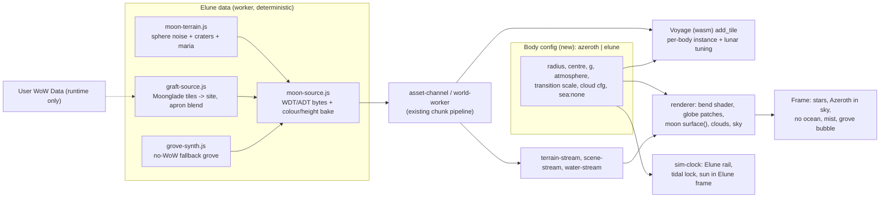

# Design: Elune, a drivable moon

Status: proposal (no code changed). Inputs read: `ARCHITECTURE.md`, `GLOBE-REFACTOR.md`, `SPACE-PHYSICS.md`, `design/{far-to-near,depth-culling,clouds,time,memory-budget,orbital-camera-controls}.md`, `space.js`, `regime.js`, `planet-frame.js`, `planet-physics.js`, `terrain-transition.js`, `globe-patches.js`, `tile-registry.js`, `height-bake.js`, `ocean-mesh.js`, `clouds.js`/`cloud-config.js`, `night-lights*.js`, `sim-clock.js`, `memory-budget.js`, `adt-synth.js`, `demo-source.js`, `loading-gate.js`, `world-music.js`, and `client/crates/flats-racer-web/src/{world,voyage}.rs`.

Goal (user): drive on Elune. A much smaller globe than Azeroth, same chunking and cloud approach, a procedural moon terrain generator instead of ocean, and one nature town on it made of duplicated Moonglade chunks (lake and trees included).

## Summary of the approach
1. Make "the planet" a parameter (`Body`) instead of a module constant. Almost every planet function already takes `radius`/`centre`; the real work is the WGSL strings that bake `PLANET_RADIUS` and the transition ranges.
2. Elune is a **second virtual map** (60 x 30 ADT tiles on the same 533.33 yd grid). A procedural generator emits **synthetic ADT bytes** exactly like `demoSource()`/`synthAdt()` already do. Render, collision, streaming, minimap, memory budget and wasm physics then run **unchanged**, and render/physics parity is free because both decode the same bytes.
3. Moonglade is **grafted** at tile granularity: real source ADTs are translated by an integer tile offset (no resampling), with a procedural apron that blends into the moon. With no WoW data, a procedural grove fills the same site.
4. One active surface body at a time. The other body is a far impostor sphere. Most of this is **JS-only**; the Rust changes are grouped into one batch.



---

## 1. World model

### Size and place
- **Radius R = 32000 / 2*pi = 5092.96 yd** (call it `ELUNE_RADIUS`). That is 1/8.4 of Azeroth (42,785 yd). Circumference is exactly **60 tiles** (32,000 yd) and pole to pole is 30 tiles, so the equirect chart tiles with no fractional wrap and fits the 64 x 64 WDT grid (`TILE = 1600/3`). Driving everywhere on the equator band loops in about 2 minutes at 270 yd/s, which feels like "a small world", yet it is as wide as one Azeroth continent.
- Orbit centre: reuse `MOONS[0]` (white moon, `orbit: 300000`), radius changed from 9000 to `ELUNE_RADIUS`. The decorative second moon is untouched.
- **Chart:** same equirect flat chart as Azeroth: `planetFrame/subPoint/globeToFlat/wrapFlat/gravityAt/circularSpeed/selectPatches` already accept `(centre, radius)`. Driveable band is **|lat| <= 55 deg**. East-west stretch is 1/cos(lat) = 1.74x at the edge. Beyond the band the chart is visible but a soft wall (or a "pole is too steep" bounce) keeps the craft out until a polar patch-only solution exists (non-goal).
- **Poles/chunks:** `MAX_LEVEL` for patches drops from 9 to 7 for Elune (level-7 cells ~4 yd, finer than the far bake needs).

### Clock coupling (`sim-clock.js`, `space.js`)
- Today `moonPlanetPosition` is decorative: `turns:1` is one orbit per `DAY_PERIOD` (24 real minutes), so the surface would move at ~1.3 kyd/s, un-chaseable. With `mu = g*R^2 = 1.96e10` the physical period at 300 kyd is `2*pi*sqrt(a^3/mu) = 7376 s` (about 5.1 Azeroth days). **Make Elune's rail physical: `ELUNE_PERIOD = 5 days` = 7200 s at 1x (`turns: 0.2`), speed ~262 yd/s.** That is slow enough to rendezvous with using the planned rocket or a scripted transfer. Rails stay analytic (SPACE-PHYSICS rule); time warp 10-1000x keeps using `SimClock` and `rate`; above 10x the rail is advanced analytically and the craft is "on rails" until the SOI is entered.
- **Tidally locked:** Elune's rotation = its orbit, so Azeroth hangs at a fixed sky position for a surface point and the Moonglade site is chosen on the near side (lat 18 deg, lon 0), so Azeroth sits ~18 deg off zenith: huge (angular diameter 2*atan(42785/252000) = 19 deg, ~38x our Moon) and phase-lit.
- **Day length:** Sun relative to Elune's frame has synodic period `1/(1 - 1/5) = 1.25` Azeroth days = **30 real minutes at 1x** (15 min day, 15 min night). `daylightAt` is generalised to `daylightAt(t, body)` using the sun vector rotated into the Elune frame (sign and handedness covered by a unit test). The existing global `timeOfDay` stays the one source of truth; nothing new to persist.
- The sun stays a direction (`sunDirection(timeOfDay)`); on Elune it is expressed in body-local coordinates. Hard directional light and `shadow.js` cascades are unchanged.

### Travel Azeroth -> Elune
- **Regimes (`regime.js`):** make `regimeOf(altitude, body)` and the bands per body. Scale the altitude ranges (`BEND_RANGE`, `GLOBE_RANGE`, `SPACE_RANGE`, `ZONE_LIGHT_RANGE`) by **sqrt(R/R_azeroth) = 0.345** (a compromise: linear scaling by R would start bending at 18 yd, below a pod's height; no scaling would keep Azeroth's 150-1500 yd band, i.e. 3-30% of R. sqrt keeps both sane; tune in M0/M3). Elune: bend [52, 518] yd, space [690, 3100] yd; **no atmosphere regime** (`ATMOSPHERE_EDGE = 0`, `densityAt = 0`).
- **Frames:** pose gains an optional `body` field (`'azeroth'` default, old saves unchanged). Camera/craft state is held in a body-centred f64 frame; on crossing the **sphere of influence** (Elune SOI r ~ 30 kyd, with hysteresis) velocity and position are transferred in the shared inertial frame (the continuity rule in `SPACE-PHYSICS.md` handoff: no step in v or q). Rendering is always eye-relative, so far distances (252 kyd) cost nothing in f32. Depth: reversed-Z is already planned; with a ~100 yd to 30 kyd far range this is no worse than Azeroth.
- **Dependency on the rocket phase:** Elune is **not blocked** by `SPACE-PHYSICS.md`. Staged:
  1. *Teleport* (map click) with a loading gate: works the moment the Elune map streams.
  2. *Kinematic cruise* ("fly" mode speed law + autopilot arc Azeroth -> SOI -> descent): ~4 min at 1 kyd/s. No new physics.
  3. *True transfer* (thrust, Hohmann-lite) after SPACE-PHYSICS phases 1-3. The Elune frame, SOI and landing frame (phase 6 there, "moon surface + landing frame") are designed here so that phase 6 reduces to wiring.

### Gravity and physics scale
- Surface gravity: **g_elune = 0.25 * g_azeroth = 2.68 yd/s^2** (see open question 4). Circular speed at the surface `sqrt(gR) = 117 yd/s`; escape `165 yd/s`. Low gravity gives big, readable jumps and lets pods fly ballistic arcs; it also means a pod above ~117 yd/s on a *true* sphere would skip, so physics must stay on the **flat chart** (below).
- **Horizon:** at eye height h the horizon is `sqrt(2*R*h)`: 3 yd -> 175 yd, 10 yd -> 320 yd, 100 yd -> 1.0 kyd, 500 yd -> 2.3 kyd. Ground-level views end almost immediately, so the near ring only has to reach the horizon at the highest relevant altitude (about 3 tiles). This is the strongest simplification: **`nearRadius` shrinks, `TILE_CAP_MIN` (8) is enough** and `globe-patches` `cull:true` removes everything past the horizon (design/depth-culling.md).
- **Flat-chart physics (recommended):** as on Azeroth, the craft is simulated in the flat chart (gravity `-Y`, local g) and the bend shader only curves the picture. With R = 5093 the error vs a true sphere is `d^2/2R`: 1.2 yd at 110 yd, 28 yd at 533 yd. That is invisible because ground and craft are bent together; it only matters for long ballistic arcs. Add a tuning term `g_eff = g - k*v_h^2/R` with `k in [0, 1]` (default 0.5) so fast pods get floaty lunar skips instead of hitting orbital speed on a flat plane. Real orbital integration begins above the SPACE_RANGE band (SPACE-PHYSICS orbital integrator, `gravityAt(alt, radius)`).
- **Up vector:** chart Y == radial up everywhere; `localAxes(pose, centre, radius)` gives east/up/south. The camera up for orbital mode uses the same function.
- **Floating origin on a small sphere:** it is easier than Azeroth. All surface coordinates are <= 16 kyd (f32 ulp 1e-3 yd), the GPU already receives eye-relative positions, and the planet frame is f64. The only new hazard is chart stretch at high |lat| (above) and the **antimeridian wrap** every 32 kyd: tile index arithmetic uses `wrapFlat` and the existing wrap delta in `spaceHud`, which now has to use the body circumference instead of the hard-coded `2*pi*PLANET_RADIUS`.

---

## 2. Terrain: the procedural moon chunk generator

**Module:** `moon-terrain.js` (pure functions, no DOM, runs in a worker and in `node --test`).

### Function of the sphere, not of the tile
`height(seed, dir)` and `albedo(seed, dir)` take a **unit vector** (from lat/lon of the vertex). Tile coordinates only choose the lattice of vertices to evaluate. Consequences: adjacent tiles are watertight by construction, there is no seam at the antimeridian or pole pinch, and `(seed, tx, ty, lod)` fully determines the output.

### Height model (yards)
```
h = base(dir)                     // continental swell: 3D simplex-like fBm, wavelength 3000-8000 yd, +-60
  + highland(dir) * rough(dir)    // 6-octave fBm, 40-1200 yd, amplitude 25
  + maria(dir)    * flatten       // low-freq mask; inside maria roughness *0.15, albedo darker, level -35
  + craters(dir)                  // layered cell craters (below)
  + wrinkle(dir)                  // thin ridges in maria (ridged noise, +-3 yd)
  + regolith(dir)                 // 2-12 yd bumpiness, 4 octaves, collision-relevant "rumble"
```
- **Craters:** for octave k with cell size `c_k = [2200, 700, 220, 70, 24] yd`, 3D cell grid on the sphere; per cell a hashed centre (jittered), radius `r in [0.15c, 0.45c]`, age. Profile per crater: `bowl = -d*(1-(u)^2)` for `u = dist/r < 1`; rim `+0.15d * exp(-((u-1)/0.15)^2)`; ejecta `+0.05d*(1/u)^3` for `u > 1`; central peak for `r > 300 yd`. Old craters are softened by `age` and by overlapping newer ones (smooth-max). Depth/diameter 0.2 (fresh) -> 0.05 (old). Only the 3 largest octaves exist at far LOD; the 2 smallest (<= 70 yd) matter for driving and only exist in the ADT tiles.
- **Determinism:** integer hashing (`imul` based, 32-bit) and polynomial smoothstep, **no `Math.sin`/`cos`/`pow` in the hot path** so results do not depend on the JS engine's libm. The test suite holds golden hashes (`height` at 64 points, tile checksum for 6 tiles) so a refactor cannot change the moon silently.
- **Albedo/colour (RGB + roughness):** highlands 0.45 grey-warm; maria 0.16 blue-grey; regolith slope darkening (steeper = exposed, brighter); fresh crater rays and ejecta bright (0.7) decaying with age; tiny noise-driven colour variation. Elune is **white-silver with a hint of lavender** (art direction: not photorealistic grey, "Elune's light"): maria tint `[0.55,0.58,0.72]`, highlands `[0.82,0.82,0.86]`.

### Chunk format and size
- **Chunk = one ADT tile**, 533.33 yd, 16 x 16 MCNK of 33.33 yd, 145 verts each (outer spacing 4.17 yd). We keep this (`ADT_TILE`, `ADT_CHUNK`, `TILE = 1600/3` in `voyage.rs`, `MAX_RESIDENT = 32`) so *zero* streaming/collision/Rust changes are needed. The generator writes MCVT heights (and a 256 x 256 RGBA colour texture + optional shader detail) into a `synthAdt`-compatible byte buffer.
- **Texture:** `TERRAIN_TEXTURE_SIZE = 256` per tile (2.08 yd/texel) holds albedo. Close-range grit comes from a **world-space procedural detail** in the terrain shader (two noise bands, 0.2-6 yd, faded by distance, tinted by the tile albedo) so no BLP assets are needed on the moon. The synthetic ADT therefore skips texture layers; a flag on the tile selects the "moon" shading path rather than the splat path.

### LOD
| Level | Use | Source | Spacing |
|---|---|---|---|
| L0 | within ~3 tiles of the player | synthetic ADT (resident, collision) | 4.17 yd |
| L1 | mid ring if the player is above ~300 yd | same generator, stride-2 decimated mesh | 8.3 yd |
| L2 | beyond the horizon / orbit | globe patches + baked height texture | 8 - 16 yd/texel |
- Far data: `height-bake` becomes body-aware: **2048 x 1024, R16** for Elune (31.4 kyd / 2048 = **15.3 yd/texel**, vs Azeroth's ~130 yd). That is already finer than the largest 3 crater octaves, so M5b ("authored height too fine for the bake") is not a blocker on Elune and the moon is a natural testbed for the unified patch tree's native-sphere near leaves (`far-to-near.md` migration step 3).
- The bake is computed progressively in the far-worker (about 2.1 M samples of the 3-octave far model at ~1.5 us = 3 s; spread over idle frames), cached in `world-store` (IndexedDB) under key `elune:{seed}:{genVersion}`. Colour bake `1024 x 512` (`bakeSurface`-like) for the globe and the map panel.

### JS vs wasm, workers
- **Start in JS** (worker): per tile 37k vertices x ~6 fBm octaves + 5 crater octaves x 27 neighbour cells ~ 12-25 ms. Budget: one tile per frame in `far-worker`/a new `moon-worker` role (design/workers.md; 4 concurrent tile generations max), cancellable on eviction, request deduplicated by `(tx,ty,lod,genVersion)`.
- **Move to Rust only if** (a) p99 tile time > ~40 ms on the target device, or (b) cross-engine float differences appear. The Rust version is a straight port (same integer hash, same crater table) in a `flats-racer-physics` module shared with `Voyage` so physics could query exact heights between tiles. It is placed in the Rust batch (milestone 8) as optional.
- **Collision parity:** the physics reads the same ADT bytes through `Voyage::add_tile(index, bytes)`, so the collision mesh equals the rendered mesh at L0. The L1 mesh is visual only (outside collision radius). Parity test: generate tile, decode with the JS ADT reader and the wasm path, compare `sample(p)` on a lattice (the Rust side exists; the check lives in JS tests with a built `pkg/` when available, otherwise skipped).
- **Per-body physics:** a body switch constructs a **new `Voyage`** from the body's manifest (`Voyage::new(json)`), with lunar `tuning()` (gravity, no drag, hover height). Residency stays `MAX_RESIDENT = 32`.

### Memory budget integration (`memory-budget.js`)
- `splitBudget` shares are unchanged (scene 40%, far 15%, terrain 20%). Elune adds: far bake 4 MiB (R16 2048x1024), colour bake 2 MiB, ~9-16 resident ADT meshes + textures (~0.35 MiB mips each, `TERRAIN_MIP_BYTES`). **Total moon-only footprint < 25 MiB**; far under Azeroth's. `residentTileCap` is allowed to return fewer than before; `nearRadius(tiles)` uses `min(horizon(altitude_max), ...)`.
- On body switch the *previous* body's tile cache and scene are flushed (`ByteBudget.release`) before the new gate opens, so peak memory never holds both worlds.

---

## 3. Rendering

### Reuse
- **Bend shader / terrain tiles / globe patches / far-to-near transition:** reused. `terrain-transition.js` takes `(altitude, body)` and returns the same `TransitionUniforms` (it already returns fixed ramps, only the ranges scale). `space.js` shaders are currently generated from top-level constants (`const R = ${PLANET_RADIUS}.0`, `DEPTH_R = R - GLOBE_DEPTH_DROP`). **Prerequisite refactor (milestone 0):** `spaceShader(body)`/`patchShader(body)`/`cloudShader(body)` become generators called per body, producing a second pipeline for Elune compiled lazily. Behaviour for Azeroth must remain bit-identical (golden shader-string test and the existing 555 tests).
- `GLOBE_DEPTH_DROP` (400 yd on Azeroth) scales with the body (~120 yd) so the globe sphere stays behind the bent terrain (design/depth-culling.md).
- **Ocean path off:** `ocean-mesh`, `water-shader` global plane, `OCEAN`/`isDeepOcean`, whirlpool dip, and the cloud shader's "land mask" are not instantiated for Elune (`body.sea = null`). `tile-registry`'s `proceduralProvider({water:false})` already does this. The local lake uses the per-tile water pass (section 4).

### Surface shading (`moonSurface()`)
New WGSL branch used by both near tiles and patches:
- Lambert from the hard sun, **no atmosphere scattering/fog** (lunar) except inside the grove bubble.
- **Earthshine fill:** a cool blue fill from the Azeroth direction, intensity = Azeroth phase x 0.06; this makes the dark side readable without breaking the "night" feel. Azeroth is at a fixed sky position so this is one uniform.
- Opposition surge / roughness: a cheap retro-reflective term (brighter when the sun is behind the camera) sells regolith.
- Slope-dependent albedo + detail noise as above. Specular none.
- **Shadows:** keep `shadow.js` cascades; the low sun and no atmosphere yield long black shadows, so ambient floor ~ 0.03 + earthshine. Cascade distances scale with the shorter horizon.

### Sky
- **Airless:** `planetFactors(altitude, enabled)` already has an `enabled` argument; for Elune the atmosphere factor is 0 so stars and sun disc are always visible, sky is black. The daylight terminator is a pure surface lighting effect.
- **Stars:** unchanged texture/pass, brighter (no extinction). Azeroth: a **textured impostor sphere** (upgrade of the current moon spheres: albedo from the colour bake `bakeSurface`, ocean specular, a baked/low-res cloud layer, thin atmosphere limb glow) drawn at its true relative position/size (19 deg), phase from the sun direction. The same impostor path draws Elune from Azeroth, replacing the flat tinted sphere in `MOONS`, then swaps to the real surface renderer at the SOI. The second moon stays a simple sphere.
- **Grove bubble (fantasy exception, see 4):** the grove has a local breathable atmosphere. `atmosphereFactor = bubble(distance to grove centre)`: 1 inside ~700 yd, smoothstep to 0 by ~1400 yd. It drives sky colour, fog, ambient and sound. The edge is shown as a faint silver-blue shimmering veil (a thin `shell` in the cloud pass with low density and an aurora-like gradient), which also hides the transition. Cheap fallback: no veil, just the factor.

### Clouds
- **Approach:** reuse `clouds.js` raymarch/curved-shell unchanged, with a per-body `CloudBody` config: `{radius, altitude, thickness, halfSize, coverage, tint, wind, features}`. `cloudUniform` stops reading `PLANET_RADIUS`/`HYJAL_SUMMIT` directly, and `cloudShellRadius(altitude, planetRadius)` already takes the radius. `CLOUD_RADIUS_GROUND_SCALE` (shell tightening near the ground) is kept.
- **Is Elune cloudy?** What looks good: **no weather clouds on the bare moon.** Instead:
  1. **Silver mist sheets** in crater floors/low basins at night (ground fog, 30-60 yd thick, coverage from `-height` and darkness), thin, slow, backlit by Azeroth: "ethereal moon mist".
  2. **Grove sky:** low-density soft cumulus + wisps inside the bubble only (coverage = bubble factor). This is where the shared cloud approach is most visible and where it reads as "Moonglade".
  3. High, sparse wisps (coverage 0.1) elsewhere only as a possible later art pass.
- Config (Elune): `altitude 180 yd, thickness 70 yd, halfSize 30 kyd -> one 32 kyd wrap`, `tier` unchanged (Standard/High), tint `[0.85,0.88,1.0]`, `features: {maelstrom:false, funnel:false}`, wind 1/4 of Azeroth. The Azeroth shell (altitude 1577 yd = 31% of R) cannot be reused: it must scale with the body.
- `CloudClock`/`cloud-flow.js` are unchanged except their domain wrap for the smaller circumference (fix the hard-coded `CLOUD_HALF_SIZE = 250000`).

### Night lights and limb
- `night-lights.js` bakes settlements into a 2048 x 1024 equirect. Elune gets its own bake with the Moonglade settlement (warm fire, `FIRE`, plus a cool "moonwell" palette: add a `moon` palette entry, `FLAG_ARCANE`), visible from orbit/approach on the night side. `settlementLights` is unchanged; add `body` to `settlementPositions`.
- **Limb:** `horizonDip(altitude, bend, radius)` already takes the radius. Limb glow on Elune is a very thin cold rim (none for the airless body except near the grove); Azeroth in the sky gets the standard atmosphere rim.

---

## 4. The nature town: Moonglade graft

### Concept
"Duplicate chunks of Moonglade": the Kalimdor Moonglade tiles are **read at runtime from the user's local WoW data** and re-emitted as Elune tiles with integer tile translation. The Kalimdor originals are untouched. Nothing from WoW data is ever written to the repo or hosted shell.

### Where chunks come from and the manifest
- A tiny hand-authored **site manifest** (committed, no game data): `elune-sites.json`
```json
{ "moonglade": {
    "source": { "map": "Kalimdor", "area": 493, "tiles": "auto" },
    "dest":   { "tx": 28, "ty": 12 },
    "yOffset": "auto",
    "apron": 1, "bubbleRadius": 700,
    "lake": "auto", "fallback": "grove-synth" } }
```
- `source.tiles: "auto"`: scan the source map's ADT MCNK `area_id == 493` (AreaTable "Moonglade"; `benilla-extract scan/world.rs` already scans these), take the bounding tiles (about 2 x 2). The result is cached in `world-store` and keyed by the WoW build hash, so the scan runs once.
- `dest`: tile indices on the Elune chart at lat ~ 18 deg, lon ~ 0 (near side). Translation is `delta = (dest - src) * 533.33` in x and z. No rotation or resample, so heights, splats, water and placements are exactly aligned.

### Reading and emitting (`graft-source.js`, worker)
For each source tile `(sx, sy)`:
1. Fetch via the existing source stack (`asset-source`/`asset-folder`/`asset-channel`, same loader that feeds `world-worker`): terrain ADT + `_obj0` (doodads MDDF, WMOs MODF) as today.
2. **Terrain:** copy MCNK heights (MCVT), alpha splats, texture layers (BLP names resolve through the normal texture path), shadow/vertex colours. Rewrite header tile indices (and MCNK x/y position fields) to the destination tile; add `yOffset`.
3. **yOffset:** chosen so the *mean height of the graft's outer-ring chunks* equals the procedural height at the site (`mean(proc(boundary))`), so the grove sits in a self-consistent basin; the apron then closes the small residual. Moonglade is already a bowl, which the generator reinforces by carving a **caldera**: `proc(dir)` receives a `siteMask` that lifts the rim to the surrounding procedural level over ~1.2 kyd (a "hidden valley in a crater").
4. **Water:** Moonglade water is liquid data in the MCNK/MH2O block (Lake Elune'ara). It is copied with `yOffset` and flows through `water-stream`/`set_scene_water` exactly like an Azeroth inland lake: a **local water plane**, not an ocean. `body.sea = null` guarantees no global sea level will fill basins on Elune.
5. **Scene:** MDDF/MODF placements `(pos + delta + yOffset, rot, scale)` are written to the scene pack consumed by `scene-stream` (`placementMatrix`, `globalCollisionVertices`). Trees, nighthaven buildings, Remulos shrine WMOs and their collision come along. They obey the scene budget (`SCENE_LIMITS`), so the 40% scene share is where Moonglade's cost lands.
6. **Bend:** doodads/WMOs are flat chart objects bent like Azeroth's, curvature over a 1.6 kyd site: `d^2/2R = 63 yd` at the far edge. Acceptable for terrain; for rigid WMOs (shrines) bend is applied per instance at its origin (existing path). Gate on a visual check in M7.

### Blending into procedural terrain (apron)
- **Heights:** the apron is the ring of tiles around the graft (width 1 tile = 533 yd). Apron tile generator evaluates `h = lerp(graftEdge(x,z), proc(dir), s)` where `graftEdge` samples the nearest graft chunk edge (clamped extrapolation) and `s = smoothstep(0, 1, d / apronWidth)`. At `d = 0`, `s = 0`, so the apron equals the graft edge height; ADT neighbours already share exact edge vertices, so there is no crack. Beyond the apron it is pure moon.
- **Colour:** apron albedo = `lerp(graftEdgeColour, regolith, s)` with a lichen/moss noise that fades with `s`, so grass thins into silver dust over ~500 yd.
- **Skirts:** the graft is whole-tile, so no partial-tile skirts exist. A small stitching pass copies the apron's graft-facing edge heights and normals from the graft's boundary row so lighting is continuous.

### Zones, NPCs, music
- **Area:** `world.area_at()` reads MCNK area ids; graft tiles keep `493`, apron/other moon tiles use synthetic ids `>= 90000` (`90001` "Elune highlands", `90002` "Mare Lunare", `90003` "Moonglade Reach" for the apron). A small JS **area overlay** (`custom-areas.js`: id -> name, music zone, light params) supplements `AreaTable` lookups for ids missing from the DBC. If the wasm `area_at` ignores unknown ids it gets handled in the Rust batch.
- **Names and HUD:** `placeName`/`nearestLandmark` get a per-body table.
- **Music:** `world-music.js` resolves area -> `ZoneMusic` row. 493 resolves to the real Moonglade tracks when data is present. Overlay entries on Elune either point to an existing quiet row (Moonglade night track) or to nothing (silence + ambient), with a distinct "vacuum" ambience. Without data, `music.js` already falls back to silence.
- **NPCs:** `npc-pack` entries whose spawn tile lies in the source set are translated with the same `delta`, so Moonglade's NPCs (Nighthaven inhabitants, Remulos, wanderers) appear. `validatePopulation` runs on the translated pack. *Unknown:* whether the NPC pack is a prebuilt extract artifact; if so a graft filter runs at extract time (Rust, batch) rather than at load.
- **Collision:** unchanged: terrain via `add_tile`, WMOs/doodads via `set_scene_mesh`/`set_scene_parts`, water via `set_scene_water`.

### Loading gate
`loading-gate.js` (`NEAR_CHUNKS = 4`, timeout 15 s) is extended with `required: [site tiles]` when the spawn is inside the bubble: the gate waits until the graft tile + its apron + ~10 scene instances are resident, with the same time-out fallback. **If a graft tile fails to load, the site degrades to the procedural grove at the same site, never to a hole.**

### Without WoW data: procedural grove (`grove-synth.js`)
Same site, same bubble, same lake position:
- Terrain: caldera basin from the generator; flat-ish meadow, moss (green/teal splat colour), lake basin carved in (radial `-12 yd` bowl + noise).
- Lake: single water quad with level = rim - 3 yd through the same water path.
- Trees: instanced low-poly procedural trees (`glb.js`-style generated meshes, 3 species, ~300 instances by Poisson-disc, hash-seeded), each with a trunk collider (capsule) in the scene pack; a few moonwell/glow stones; fireflies from `particles.js`.
- This is also the **test fixture** for the graft (same manifest shape, same `required` tiles), so CI never needs game data.

---

## 5. Racing and gameplay
- **Pods:** the same hover racers with a "lunar" tuning profile: `g = 2.68`, no aerodynamic drag, `k = 0.5` curvature relief, higher hover clearance, stronger lateral grip (regolith). `vehicle-model.js`/`vehicles.js` already take tuning; `Voyage::set_tuning(...)` supplies gravity. Top speed unchanged initially; cap to ~110 yd/s without lunar skip, or let `k` absorb it (open question 4).
- **Tracks:** `race-gates.js`/`track-normalize.js` already normalise tracks by world. Add `tracks/elune/*.json` per body (committed, no game data): (1) "Grove Loop" (through the bubble, around the lake: needs graft or fallback), (2) "Crater Rim" (follows a large crater, ~6 kyd), (3) "Mare Run" (flat maria sprint, ~12 kyd). Gates snap to terrain height at load via the heightfield. The existing track editor works with the body selector.
- **Map/teleport:** `map-panel.js`/`worldmap.js` get a **body tab** (Azeroth | Elune). The Elune map is the colour bake (1024 x 512 equirect) with POIs: Moonglade site, launch pad(s), track starts. `teleport(to: {body, x, z})` shows the loading gate and respawns at the point. The existing minimap (32 px per tile) is generated from the tile albedo.
- **Sound:** airless outside the bubble: no wind, engine heard through the hull (low-pass ~400 Hz, no Doppler/air roar), hover thump and tyre grit conducted through the craft; inside the bubble normal sound. Bubble crossing crossfades over 1.5 s. Music only inside the bubble and on the map (optional silence elsewhere). Gate chimes unchanged.
- **Gameplay hooks later:** Azeroth return pad; "moon moths" in the grove; arcane pylons as checkpoints.

---

## 6. Data and work breakdown

### Key unknowns / risks
| Risk | Mitigation |
|---|---|
| Shaders bake `PLANET_RADIUS` and transition ranges; second body needs a second pipeline | Milestone 0 refactor with golden tests; no behaviour change for Azeroth |
| Flat-chart physics distortion at |lat| > 55 deg | Restrict driving band, document; patch-only polar caps later |
| Moonglade source tile set / area detection is unverified | M7 starts with a read-only census tool (like `wmo_chunk_census` example) |
| WMOs + doodads do not bend plausibly at R = 5 kyd | Per-instance bend visual check in M7; fall back to un-bent doodads if there is a visual issue |
| `area_at` and NPC pack formats may not accept synthetic ids/graft | Overlay in JS first; Rust fix in batch |
| `Voyage` tuning may not expose all lunar terms (curvature relief) | Verified in M2; term added in Rust batch |
| JS tile generation cost on low-end devices | Cap concurrency, bake L2 progressively, Rust port option |
| Time warp (1000x) with a moving, 262 yd/s target | Rails are analytic; clamp warp near SOI; teleport doesn't need it |
| Licensing | Graft is runtime-only, from the user's data, never in dist/repo; fallback grove is original |

### Milestones (each independently shippable, with tests)
| # | Milestone | Size | JS-only? | Tests |
|---|---|---|---|---|
| 0 | **Body abstraction:** `bodies.js` (`azeroth`, `elune`), thread `body` through `space.js`, `regime.js`, `terrain-transition.js`, `planet-physics.js`, `memory-budget` nearRadius, shader generators per body. Azeroth output identical. | M (3-4 d) | Yes | golden shader strings, ramps scaled by sqrt(R), existing 555 pass |
| 1 | **`moon-terrain.js`** generator (height, craters, maria, albedo), golden hashes, perf bench | S-M (2-3 d) | Yes | determinism, watertight edges across tiles/antimeridian, crater stats, ms/tile |
| 2 | **`moon-source.js`**: synth ADT/WDT for Elune; `?body=elune` debug entry; per-body `Voyage` + lunar tuning; drive on the bare moon with the existing renderer | M (3-4 d) | Yes (if tuning suffices) | tile bytes decode; collision parity vs JS sampler; drive sweep p99 |
| 3 | **Moon rendering:** `moonSurface()`, airless sky, earthshine, shadows, far bake R16 + patches (radius 5093, level <= 7), no ocean | M-L (4-5 d) | Yes | shader compile (headless), seam captures (low alt, limb, terminator), bake cache hit test |
| 4 | **Sky and clock:** Azeroth impostor in the sky, textured Elune impostor from Azeroth, physical rail (5-day period), tidal lock, sun in Elune frame, 30 min synodic day | M (3 d) | Yes | rail speed/period, sun vector handedness, daylight curve, sim-clock scale tests |
| 5 | **Clouds/mist + bubble atmosphere:** `CloudBody`, silver mist, grove clouds, bubble factor/veil, per-body `CLOUD_HALF_SIZE` | M (3-4 d) | Yes | `cloud-march` mirror vs WGSL golden for new config, Azeroth cloud uniform unchanged |
| 6 | **Site framework + procedural grove:** `elune-sites.json`, caldera `siteMask`, apron blend, lake, procedural trees, bubble centre, loading gate `required` tiles, night-light entry | M-L (4-5 d) | Yes | apron edge equals graft edge (crack-free), gate waits then degrades, scene budget |
| 7 | **Moonglade graft (real data):** census tool, `graft-source.js` (ADT/obj0 translate, yOffset, water, placements), apron colour blend, area overlay + music + NPC translation | L (5-7 d) | Yes (NPC filter may need extract-time Rust) | synthetic source fixture with fake ADTs; translation math; real-data smoke (local, skipped in CI) |
| 8 | **Rust/wasm batch** (one cargo session): `area_at` synthetic ids, curvature-relief + lunar tuning fields, optional wasm generator port and exact height query, extract-time NPC graft filter if needed, per-body world id in `Voyage` manifest | M (3-4 d) | **No** | cargo tests, wasm build once, JS parity test activated |
| 9 | **Travel + map:** body tab, teleport with gate, kinematic cruise + SOI frame switch, `pose.body` persistence | M (3-4 d) | Yes | frame handoff continuity (dv, dq bounded), save/load round trip, old-save loads |
| 10 | **Racing + sound:** lunar pod tuning, 3 tracks, vacuum audio, bubble crossfade, Elune HUD names | M (3 d) | Yes | track normaliser, gate order, audio graph tests |

About **36-47 days** sequential. Milestones 1 -> 2 -> 3 give a drivable airless moon with zero Rust. Milestone 8 is the only mandatory cargo work and is grouped so it is built once; milestones 0-7 and 9-10 run without it (flagged features degrade: overlay-only area ids, curvature relief off). The SPACE-PHYSICS rocket work is an *enhancer* of 9 and not a prerequisite.

### Suggested order of risk reduction
M0, M1 and M2 prove the architecture (second body, ADT synthesis, drivable moon). M6 proves the site/apron/gate framework with original art before M7 touches game data.

---

## 7. Open questions (recommendations)
1. **Size.** Is R = 5093 yd (60 tiles round) right, or bigger (e.g. 8 kyd) for longer tracks? *Recommend 5093*: tile-exact wrap, 1/8 of Azeroth, reads as a "planetoid", whole world resident in the far bake; revisit after a play test.
2. **Azeroth -> Elune travel.** Ship teleport + kinematic cruise first and treat true rocket transfer as an upgrade? *Recommend yes*: Elune delivers independently of SPACE-PHYSICS; the frame/SOI design is compatible.
3. **Atmosphere.** Airless moon with a Moonglade **breathable bubble** (silver veil edge), or a thin fantasy sky everywhere? *Recommend bubble*: it keeps the moon lunar and makes the grove feel special; fallback is a hard fog edge.
4. **Gravity and pod speed.** Lunar g = 0.25 Azeroth with a curvature-relief term, or keep Azeroth g for familiar handling? *Recommend 0.25 g with `k = 0.5`*, plus per-track speed caps; tune in M10 and expose in the tuning panel.
5. **Moonglade scope.** Graft the full Moonglade (Nighthaven, shrine, NPCs, music) or just terrain, lake and trees for v1? *Recommend terrain + lake + trees + area/music first* (M6-M7), NPCs as a follow-up inside M7 only if the pack format allows a load-time filter.
