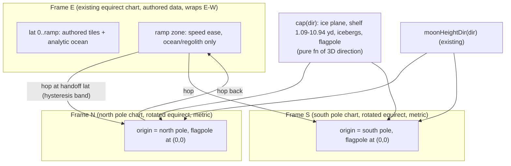

# Poles and full-world traversal (Azeroth and Elune)

Status: design proposal, no code. Supersedes the "rolling tangent-plane chart" and "rotated chart swap" ideas (commits 4a15ef4b / 465ee0a6 and the polar wall are dropped; the *math* of a rotated chart is reused below, the *swap* is not).

## 1. Goal and decisions

User requirements (fixed):

1. Drive or fly anywhere on Azeroth or Elune, **including both poles**, and around the full circumference.
2. **Azeroth poles**: a procedural plane of ice and snow, a flagpole at the pole. Where ice meets water, an **ice shelf 1-10 m above sea level** (1 m = 1.0936 yd, so **1.09-10.94 yd**). Occasional small **icebergs in the water within ~0.5 km (547 yd)** of the ice.
3. **Elune poles**: a flagpole each; otherwise the existing moon terrain, unchanged.
4. **No loading delays while driving, no visible seams.**

Decisions already made by the user:

- Poles are fully procedural. Real WoW data stays below ~75 deg and **keeps its authored equirect chart** (E-W stretch 1.65x at Darnassus ~53 deg, 1.94x at the Kalimdor tip ~59 deg). Nothing is resampled.
- The plan must support full circumnavigation; Rust has no longitude wrap today.
- The seam where the authored chart meets the metric procedural zone goes over open ocean, with the scale eased over a few km.

## 2. What the code does today (verified)

| Fact | Where |
|---|---|
| One equirect chart per body: `lon=(x-cx)/R`, `lat=(cz-z)/R`. Every pole is the singular row `z = cz -/+ R*pi/2`. | `browser\equirect.js:8-11`, `browser\space.js:28-38` |
| Azeroth `R = round(29867 / (120 deg in rad)) = 14260 yd` (circumference ~89,600 yd; the 64x64 ADT grid is only ~34,133 yd). Elune `R = 32000/(2 pi) = 5092.96 yd`, grid 60x30 tiles = exactly one circumference. | `browser\space.js:10`, `browser\bodies.js:11-12`, `browser\moon-source.js:6-7` |
| Fly mode already wraps: longitude wraps and crossing a pole maps `lat' = pi-lat, lon+pi` and flips the heading. That is a *teleport on a singular chart*: the tiles there are the stretched equirect ones. | `browser\space.js:40-50`, `browser\flight.js:36`, `browser\app-frame.js:59` |
| Rust drive physics is flat Y-up in chart yards; `Voyage` keeps an f64 `origin` and a `rebase()` that re-bases when the local position exceeds 256 yd. No longitude wrap, no pole handling. | `client\crates\flats-racer-web\src\voyage.rs:113,150,162,231-239` |
| `sample_at(p)`: `locate(p)` finds a resident tile, else falls through to **analytic ocean** (`contains(manifest.ocean,p)`, or `exterior_ocean` for manifest v3), else `availability 2` (void). So open ocean needs **no tiles**. | `voyage.rs:246-345`, `world.rs:256-275` |
| `Manifest` already holds multiple `Region`s (Kalimdor, Eastern Kingdoms) with a `placement`, each with its own tile grid; Elune is one region built by `build_moon`. | `voyage\types.rs:7-13,61-74`, `world.rs:65-127,145-185` |
| Elune terrain is a pure function of a unit direction (integer-hash noise, rounded to 1/64 yd); only `chartDir(x,z)` ties it to the chart. Tiles are synthesised in JS as fake ADTs, so no data and no wasm port. | `browser\moon-terrain.js:1-3,55-58`, `browser\moon-source.js:1-8` |
| Sun/clock: Azeroth keeps the global clock curve (`daylightAt(t)`, bit-identical); Elune uses the true position-based sun. `localSunAt` already works from `planetFrame(...).up`, so it is fine at a pole (up is defined; east/south are not). | `browser\sky-coupling.js:15-28`, `browser\local-sun.js:9-12`, `browser\clouds.js:19-22` |
| Cloud flow already fades its zonal wind to zero toward the pole (80-89 deg). | `browser\cloud-flow.js:14-17` |
| Pod launch lands through `world.pod_land(pose4, velocity3)`. | `browser\pod-driver.js:62-66`, `voyage.rs:1278` |
| Tile residency is capped by the memory budget (`bodyTileCap`) and streamed by `stream()` in the worker, nearest first. | `browser\memory-budget.js:137-141`, `browser\world-engine.js:238-242` |

Consequences:

- The distortion is **only the chart**. Terrain data is already direction-based (Elune) or ocean/analytic (Azeroth poles). So nothing about the *content* needs resampling.
- Open-ocean and procedural zones need **no authored tiles**, so a frame change inside them can be loading-free if the destination's tiles are synthesised in JS and pre-streamed.

## 3. Challenge to the "rolling tangent-plane chart"

A chart re-centred continuously on the pod must regenerate the whole resident lattice at every re-centre, and everything keyed to chart coordinates (tracks, flags, graft, NPCs, map poses, far shaders, pose links) must follow. That is the hitch the chart-swap prototype showed (~8 s per swap, `moon-chart` experiment).

With poles decided to be procedural, something simpler is correct:

> **Three fixed frames per body, handed off only inside procedural/ocean content**:
> **E** (today's equirect chart, authored data, wraps in longitude), **N** and **S** (a *pole chart*: the same equirect chart, rotated so the pole sits at the chart origin).

Why this is enough:

- Authored content (Kalimdor, Eastern Kingdoms, the Moonglade graft, the Elune Loop) lives in E and never moves. No rolling.
- A pole chart centred on the pole has the pole as an ordinary regular point (chart origin, lat 0 lon 0 of the rotated chart). Within the cap radius (~18-30 deg) the stretch is `1/cos(<=30 deg) <= 1.15`, and the pole itself has stretch 1. No singularity, no streaking.
- A rotated equirect is a **3x3 rotation Q applied to the direction before the existing equirect math** (`dir_E = Q * dir_pole`). Every consumer that already speaks equirect (shaders, `planetFrame`, cloud `worldAt`, `moonHeightDir(chartDir)`) gets one extra matrix, not a new projection. The azimuthal-equidistant alternative is exactly metric to the rim but needs a new branch in every WGSL copy; keep it as the fallback only if 1.15x is judged visible.
- Hand-off happens over **ocean (Azeroth) or procedural regolith (Elune)**, where the destination's content is a pure function. It is a pose re-expression plus a pre-streamed tile set, not an engine re-open.

If you still dislike discrete frames, a fully continuous alternative exists (a pole-centred azimuthal chart *plus* a warped E near the seam), but warping E-W scale per row introduces shear proportional to the distance from the central meridian (tens of km), which is why I do not recommend it.

### Frame model



## 4. Frame model in detail

### 4.1 Frames

`browser\frames.js` (new, pure, mirrored by Rust constants and a unify-style test like `unify.test.mjs`):

```
Frame { id: 'E'|'N'|'S', Q: 3x3 (dir_E = Q * dir_frame), centre, radius }
frameFor(body, dir, current)  -> id, with hysteresis
hop(pose, vel, yaw, from, to) -> { pose, vel, yaw }   // exact, closed form
```

- E: identity Q, today's `centre` (`WORLD_CENTRE` for Azeroth), unchanged coordinates. **Every existing pose, track, gate, flag, ramp, NPC and pose link stays valid with an implicit `frame: 'E'`.**
- N/S: Q rotates the pole to the chart origin; chart x = east along the rotated equator, chart z = south, origin = pole. The chart is local (small patch), so there is no wrap and no seam inside it.
- Heading convention at the exact pole: **chart yaw is the heading**, with chart -z ("up the screen" at yaw 0) pointing along the lon-0 meridian away from the pole in N, and along the same meridian in S. At the pole the compass shows "POLE" plus a bearing to the lon-0 meridian (grid heading), never a geographic N/E.

### 4.2 Hand-off (hop)

- Trigger: `|lat|` crosses `handoff` in E, or `colat` crosses the same circle in N/S, with a hysteresis band (+-1 deg) so jitter on the circle cannot ping-pong.
- A hop is a pure re-expression: position through the body direction, heading through the Jacobian (`chartVector`, meridian convergence = longitude difference), **true ground speed conserved**. The geometry the player sees is identical before and after; only the coordinate system under it changes.
- Pre-stream: from `ramp start` onward the worker streams the destination frame's synthesized tiles around the *predicted* hop position (same `stream()` window, `world-engine.js:238-242`), so the hop finds them resident (no `availability 1`, no stall).
- Rust: `Voyage` holds all three frames at once as regions in one manifest (see 6), and a hop is an atomic `origin`/position/yaw/velocity re-seat in the style of the existing atomic rebase and its rollback test (`voyage\tests.rs:422`).

Parameters (per body, tunable):

| | ramp start | handoff | cap/ice edge | notes |
|---|---|---|---|---|
| Azeroth | 62 deg | **72 deg** | ice edge ~80 deg (colat ~10 deg = ~2.5 kyd) | Kalimdor tip 59 deg, WDL/ADT grid ends ~75 deg; seam is open ocean |
| Elune | 40 deg | **60 deg** | none (existing moon terrain) | graft and Elune Loop are near the equator |

### 4.3 Scale ease (the authored-chart / metric seam)

Equirect stretch at lat 72 deg is 3.24x: the same pod command moves the pod 3.24x slower E-W in *true* yards than N-S. A hop that conserves true speed would make E-W motion suddenly 3.2x faster. So inside the ramp zone (Azeroth 62-72 deg = ~2.5 kyd of arc; Elune 40-60 deg) Rust applies a latitude **metric ramp** `m(phi)` to the *E-W chart displacement* of the pod:

```
m = 1                          phi <= ramp_start
m = lerp_smooth(1, 1/cos(h))   ramp_start < phi < handoff      (h = handoff lat)
dx_chart_applied = dx_physics * m
```

so true E-W speed approaches the pod's real speed exactly at the hop and is continuous across it. Chart x is still `R*lon`, so poses stay consistent; only the integrator differs. Only ocean/regolith exists in the zone, so nothing authored is distorted (rule: validate that no track/gate/ramp is authored inside the ramp zone). Below `ramp start` behaviour is bit-identical to today (golden shots unchanged).

### 4.4 Longitude wrap (E frame)

- Azeroth: circumference 2*pi*14260 = ~89,600 yd. Only ~34,133 yd has tiles, the rest is analytic ocean. Wrap = **shift `origin` by +-2*pi*R and re-seat** (the f64 `origin` already exists), applied before `locate`. Authored tiles are keyed by position, so `locate` also needs the wrapped coordinate.
- Elune: the 60-tile lattice spans exactly one circumference (32,000 yd), so `locate` takes the tile column **modulo 60** and the JS generator is already direction-based, so heights agree across the wrap bit for bit.
- JS: `wrapFlat` (`space.js:41-50`) stays for fly mode longitude only; its pole flip (`flight.js:36`) is replaced by a real frame hop (L4).

## 5. Procedural cap function

Pure function of the 3D unit direction `d` (body frame). Integer-hash value noise only, output rounded to 1/64 yd, same scheme as `moonHeightDir` (`moon-terrain.js:1-3`), so any later port matches bit for bit and tiles agree on every shared edge. **No data, no loading beyond tile synthesis** (Elune tile cost has not been profiled in isolation; the spike measures it).

```
colat   = acos(|d.y|)                        // angle from the nearest pole
edge    = EDGE0 + A*fbm(lon-only noise)      // shelf edge colatitude, ~10 deg +- 1.5 deg
inIce   = colat < edge
shelfH  = 1.09 + (10.94-1.09)*smoothnoise(d*k)   // yd above sea, 1-10 m
iceH    = shelfH                              // flat plane, tiny sastrugi (+-0.15 yd) for texture only
bergs:  (colat, lon) grid, cells ~250 yd, hash -> 30% occupied (measured: ~48 bergs, 0.3% belt coverage), jittered centre,
        radius 6-25 yd, faceted top (max of 3-5 planes), top 1-6 yd above water,
        only for  edge < colat < edge + 547 yd/R  (0.5 km band)
ground  = max(iceH if inIce else -inf, berg top)
water   = sea level where ground < sea
```

Details and rules:

- The ice **shelf edge** is a short steep ramp (1-2 yd run) so the hover pod can drive off it and fall into the water, and so the edge is a clean silhouette in the minimap. Bergs only in the 0.5 km band, so the open ocean stays open.
- Beyond the band to the seam: plain ocean (same analytic ocean as today, sea level 0).
- The **flagpole** is a placed doodad at the chart origin of N and S (and on Elune): a procedural pole (~14 yd, pole-flag.js) carrying a **WoW flag model loaded at runtime** through the normal doodad path (Horde north: world\generic\pvp\battlefieldbanners\battlefieldbannerhorde.mdx, Alliance south: ...battlefieldbanneralliance.mdx; fallbacks hordebanner02/stormwindlionbanner; all verified present in the 1.12.1 data). Nothing WoW-derived is committed or baked; tests use stand-ins. Collision via `set_scene_bounds` (`voyage.rs:918`), the same path other scenery boxes use. It stands at the exact pole in the pole frame, so no seam logic is needed.
- Surface colours (snow white/ice blue for Azeroth, with slight blue in shadow; none for Elune, which keeps regolith) are produced from the **same function** for near tiles, the minimap, and the globe colour grid, so far/near/map agree.
- **Elune**: pole frames call `moonHeightDir`/`moonAlbedo` with the pole-chart direction (`chartDir` gains the rotation Q). No fade, no cap. Flagpole only.

## 6. Rust / wasm changes (per file)

All in **one cargo build group** (R1). No change to the physics crate (`flats-racer-physics\src\lib.rs`): the pod stays flat Y-up; the ramp is applied by the caller.

| File | Change |
|---|---|
| `voyage\types.rs:7,61` | `Region` gains `frame: u8` and a frame table (`Q`, hop circle, ramp start) in `Manifest`; bump manifest `version`. |
| `world.rs:65-127,145-185` | `build_world`/`build_moon` add N and S pole regions (small grids, e.g. ~18x18 tiles Azeroth, ~12x12 Elune) with `placement` rectangles far enough apart that frames never overlap in flat space. Keep region ids stable (regions 0-1 stay Kalimdor/EK). |
| `world.rs:256-275` | `locate`/`exterior_ocean`: wrap the x coordinate for E (shift/modulo), restrict the existing analytic ocean branch to E, and treat pole regions as tile-only (cap content is synthetic tiles). |
| `voyage.rs:231-239` | Extend `rebase()` with `hop(frame)` (atomic, same rollback shape as the existing rebase); frame id lives in `Voyage` state and is returned to JS in telemetry. |
| `voyage.rs:246-345` | `sample_at` is frame-aware (region by frame); no new analytic branch needed for poles. |
| `voyage.rs:465-506` | `advance`/`advance_substep` apply the metric ramp `m(phi)` to the E-W displacement in E and trigger `hop` after the substep. |
| `voyage.rs:434`, `1278` | `restore_pose` and `pod_land` take a frame id (default E). |
| `voyage\tests.rs` | Tests: ramp continuity, hop round trip, wrap, hysteresis, no `availability 1` at the hop with pre-streamed tiles. |
| `flats-racer-web\src\lib.rs`/bindings | Expose frame id in the telemetry vector (append, do not reorder). |

Wasm rebuild points: **R1 only** (everything above together). Everything else is JS-only and can be built and shipped first.

## 7. JS / worker / renderer changes

- `browser\frames.js` + `frames.test.mjs` (new): frame defs, `frameFor`, `hop`, `chartVector`, metric ramp (mirrored in Rust, guarded like `unify.test.mjs`).
- `browser\pole-source.js` (new): synthesises pole-frame ADTs (Azeroth ice cap and Elune regolith) the way `moon-source.js` does; flagpole instance; iceberg placement is part of terrain (no doodads).
- `world-engine.js:238-242` `stream()`: window follows the predicted hop target; `restorePose`/`pod_land` get a frame argument; protocol message for `hop` (protocol files touched recently on main; coordinate).
- `space.js:28-38`, `planet-frame.js:9-21`: `planetFrame`/`subPoint`/`toPlanet`/`fromPlanet` take a frame (Q). `latLonOf` remains the only chart<->lat/lon function.
- Shaders (bend, surface, lights, cloud `worldAt`): one `mat3` frame uniform applied before the equirect math; extend `unify.test.mjs` mirror guard. **Per-draw frame**, because for a few frames after a hop the horizon/near instances of the previous frame may still be drawn; they are drawn under their own frame uniform and expire as the pre-hop tiles evict (see risks).
- Fly mode: `flight.js:36` replaced by `frameFor` + `hop` on the same thresholds; keeps camera attitude by converting the quaternion through `chartVector` (the earlier `turnAround` hack at `app-frame.js:59` is removed).
- Pose links: `pose.frame` (optional, default `E`); restore accepts it. Pose export of a pole pose is stored in its own frame (no conversion needed because every frame is a legal chart).
- Camera: collision (`cameraCollision`) is chart-independent (uses `max(ground, water)`); pole poses only need the pole-frame ground query. Chase camera yaw hop is applied together with the pod hop in the same frame (no visible swing).

## 8. Elune vs Azeroth

| | Azeroth | Elune |
|---|---|---|
| Pole content | Ice plane + shelf + bergs + flagpole | Existing moon terrain + flagpole |
| Authored data | Kalimdor/EK below ~59 deg; keep chart | Moonglade graft + Elune Loop near equator; keep chart |
| Seam over | Open ocean (62-72 deg) | Procedural regolith (40-60 deg), no visible material change (same function) |
| Ocean | Analytic E ocean continues in N/S regions up to the shelf | None; no water except the Moonglade lake |
| Lighting | Clock curve (see Q2) | Position-based sun: poles get low-sun long shadows and permanent twilight unless tilt is added (Q2) |
| Wrap | 89,600 yd, origin shift | 32,000 yd, modulo 60 columns |
| Handoff | 72 deg, ramp 62-72 | 60 deg, ramp 40-60 |
| Gravity | `POD_GRAVITY_SCALE.azeroth=1` | `.elune=0.5` (`bodies.js:15`) |

## 9. Cross-cutting features

- **Shadows**: shadow/directional light uses the local sun already position-based on Elune; on Azeroth it follows the clock curve, so at the poles the sun direction is *the same as everywhere*. Because pole frames use rotated axes, the light vector must be rotated by Q once per frame (not recomputed per tile). Test with sun elevation sampled at the pole.
- **Camera**: orbital/chase camera up vector comes from `planetFrame.up`, fine at the pole; yaw is a grid yaw. `cameraCollision` clamps above `max(terrain, water)+margin` (already in place).
- **Compass / HUD**: heading readout in pole frames is grid heading; show "POLE" within ~200 yd of the flagpole; `bearing()` (`race.js:114`) is chart-local so gates in a pole frame work if tracks carry a frame.
- **Tracks / gates / ramps**: stored in chart yards with an implicit `frame: 'E'`. Add optional `frame` to track and ramp records; v1 disables the track editor inside the ramp zone and pole frames (greyed with a message), v2 allows pole-frame tracks (a "pole run" track around the flagpole is a good showpiece).
- **Minimap / map panel / world map**: the equirect map art ends at the top/bottom rows; render ice caps as white bands above ~78 deg (from the same cap colour function) (no pole teleport icons: poles are reached by flying/driving only).
- **Far globe / space map art**: globe colour/height grids (`PLANET_STATE` grids in `renderer-events.js:17`) are filled from the cap function above 75 deg (cross-fade 70-75) so the globe shows white caps that match the near view; far shelf/berg detail is not drawn (sub-pixel).
- **Pod launch landing**: ballistic landing resolves the target in 3D direction; the landing step calls `frameFor(dir)` and seats via `pod_land(pose, vel, frame)`. A launch that crosses a pole is simulated in inertial/globe space already (`pod-launch.md`), so only the **final seat** needs the frame.
- **Sound/music**: no change; zones for polar frames need an area id (add synthetic `ICE_CAP` area like `ELUNE_AREA`, `moon-terrain.js` convention).
- **Clouds**: curved shell clouds use true planet radius (`clouds.js:23-24`); the cloud `worldAt` needs the frame matrix (above). Flow already fades to zero at the pole (`cloud-flow.js:27`).

## 10. Open items flagged separately (not in this design's scope)

- **Polar day/night** (Q2).
- **Planet ripple at speed**: the user-reported distortion of the planet while moving fast is a separate bug (suspected bend/precision at velocity) and must not be conflated with polar rendering; verify after L3 whether it persists in pole frames.

## 11. Performance and budget

- p99 handler target ~20 ms and 0 console errors (existing drive gate). Per frame additions: one mat3 multiply in `planetFrame`, one latitude test and the ramp multiply per physics substep. Negligible.
- Tile synthesis: unmeasured today (the `ms` values in `elune-pose-shot` output are per-tile frame metrics, ~14-18, not synthesis time); the pole cap is simpler (plane + noise), target **<= 10 ms/tile**, to be measured in the spike; resident tiles are bounded by `bodyTileCap` (`memory-budget.js:141`), the pole regions share that budget (they never add to it because only the frame in use plus the pre-streamed destination are resident).
- **Hop frame cost**: re-express pose, swap frame uniform, and (at most) drop/evict the previous frame's far tiles over several frames; budget **< 2 ms** in the hop frame, and zero worker round trips on the critical path (tiles pre-streamed).
- Memory: pre-streamed destination tiles (<= 9) for ~3 s around each hop; within the existing cap.

## 12. Test and gate plan

Unit (node:test):

- `frames.test.mjs`: hop round trip (position, heading, ground speed, many random poses), hysteresis (no ping-pong on the circle), wrap at +-pi*R, ramp continuity and `m=1` below ramp start, rotated-chart distortion bound `<= 1.15` inside the cap radius, pole heading convention.
- `pole-source.test.mjs`: cap determinism (same seed/direction = same bytes), edge agreement across tile and chunk borders, shelf height in 1.09-10.94 yd, bergs only inside 0.5 km and within size range, ice colour agrees between near/minimap/globe, flagpole at origin.
- Rust: ramp continuity, atomic hop and rollback, wrap `locate`, `availability` never 1 across a hop with pre-streamed tiles.
- Mirror guards: WGSL `mat3` frame vs `frames.js` in `unify.test.mjs`.

Real-data smokes (via `heavy-lock.mjs`):

- **Pole crossing** with `driving-smoke.mjs`: add `POLE_CROSS=1` (env style already used there: `TELEPORT_BODY`, `YAW`, `DRIVE_SECONDS`); spawn at lat 60 yaw toward the pole, hold W through the pole and out the other side on both bodies. Assertions: 0 console errors; exactly the expected hops (2); true ground speed continuous across hops (|delta| < 3 %); no teleport > N yd per frame in 3D; **0 frames with tile availability 1** (no loading); handler p99 < 20 ms; no pixel discontinuity at the seam (shot diff of the frames before/after the hop).
- **Circumnavigation** at lat 0 and lat 60 on both bodies: drive one full circumference; position continuity at the wrap (`origin` shift), no errors, no stall.
- Shots at lat 60 / 75 / 85 / pole on both bodies (`elune-pose-shot.mjs` with `POSES`), before/after.
- **Golden Azeroth gates** (coordinator-run): below the ramp start behaviour is bit-identical, so goldens must not change.

## 13. Layers, effort, order

| # | Layer | Effort | Wasm |
|---|---|---|---|
| **L0** | `frames.js` (+tests), cap function, pole-source tile synth, flagpole mesh | **M** | JS only |
| **SPIKE** | See below: cap + seam measurement | **S** | JS only |
| **L1** | Pole-frame near rendering in a *test* body-world (like `moonEngine`): open N/S as regions, drive on the cap without hops | **M** | JS only (reuses regions) |
| **L2** | Rust: frame regions, E wrap, hop, metric ramp, `restore_pose`/`pod_land` frame arg, tests (**R1**) | **L** | **R1** |
| **L3** | Renderer frame uniform (`mat3`) in bend/surface/lights/cloud, per-draw frame, globe caps | **L** | JS only |
| **L4** | Fly-mode hop, pose-link `frame`, restore retry, camera yaw hop | **M** | JS only |
| **L5** | Map panel/minimap caps, compass/HUD, tracks `frame` field, pole teleports, pod-launch landing | **M** | JS only |
| **L6** | Lighting decision (Q2), polish, perf tuning, optional pole-frame tracks | **S-M** | none |

Order: L0 -> SPIKE -> L1 -> **R1 (L2)** -> L3 -> L4 -> L5 -> L6. L0/L1/L3/L4/L5 are JS-only, so only one cargo build is needed; do not start L3 against an unmerged R1 shape (agree the frame uniform and telemetry layout first).

### Recommended first spike (JS only, no cargo)

1. Implement the cap function and `pole-source.js` for Azeroth N.
2. Open the cap as a standalone region (the existing Elune-style engine path) and place a *flat* seam rectangle of ocean beside it, with the ice edge ~10 deg from the pole and a camera at the 72 deg seam.
3. Measure: **tile synthesis ms (p50/p99)**, time from arrival to first resident tile (should be 0 when pre-streamed), **seam visibility** (shot diff across the ocean/ice colour and height at the seam; waves/normals mismatch), shelf-edge silhouette quality and berg density.
4. Output: numbers plus shots; go/no-go for the rotated-equirect pole frame vs the azimuthal fallback.

## 14. Risks and unknowns

- **Dual-frame rendering during a hop** (largest): near/horizon instances placed in the previous frame must keep drawing correctly while the new frame's tiles take over; mitigated by per-draw frame uniforms and by hopping over open ocean (no authored instances within view except far horizon landmarks like the Nordrassil landmark, which should be converted by `hop` like any instance).
- **Worker protocol churn**: `world-engine.js` / `world-client.js` / worker protocol were just changed on main; `stream()` plus `restore` paths must be re-read before L2/L3.
- **Authored-chart seam at the ocean**: the wave/ocean normal texture is in chart yards; across the hop the wave pattern is continuous in true space but not in chart space (a visible, slow wave stretch in the ramp zone). Mitigation: fade ocean detail with distance and do the hop at the point of minimum stretch change; measure in the spike.
- **Far horizon/globe art** needs the same caps; mismatch between near white and far blue would be a visible pop at the transition altitude.
- **Pose-link compatibility**: add `frame` as optional; old links restore in E exactly as today.
- **Moonglade graft / tracks in E only**: pole frames have no graft; teleports from a pole to Moonglade hop to E.
- Chart stretch inside a pole frame reaches 1.15x at the cap rim for Elune (30 deg); acceptable for regolith, check in shots; if not, shrink the cap radius or use the azimuthal chart.

## 15. Decisions (user review) and remaining questions

Answered:

1. **Pole frames: rotated equirect** (implemented in `frames.js`; azimuthal stays the fallback only if shots show 1.15x on Elune is visible).
2. **Polar light: tilt imitation, no seasons.** `polar-light.js`: weight `smoothstep(60 deg, 80 deg, |lat|)` nudges the *local* sun vector toward -Y by 0.16 (about 9 deg), so the **north pole is eternal night, the south pole eternal day** (low golden sun, shadows sweep around the pole), and anything below 60 deg is bit-identical (golden shots unchanged). Azeroth, whose light is the global clock curve, blends the scalar daylight toward 0 (north; keep the existing night look: stars, moon, ambient floor, a lamp on the Horde flag so north is legible, not black) or 0.78 (south) with the same weight (`polarDaylight`). **Elune** has a position-based sun and its poles already graze; apply the same 0.16 nudge to the local sun used for Elune lighting only (the shared orbit and the sky/Azeroth-phase are untouched, a known cosmetic inconsistency at the pole), so Elune's north is also night (earthlight/Azeroth-light fills in) and south day. Wired in L6; the pure functions and tests land in L0.
3. **Tracks/gates in pole frames and the ramp zone: forbidden in v1** (validation rejects them); pole tracks are v2.
4. **Ice cap about 2.5 kyd radius with a ~548 yd berg belt: yes.**
5. **Flags: Horde at the north pole, Alliance at the south pole**, WoW banner models at runtime (see 5), procedural pole. Elune poles use the same pair (**assumption**: the user only asked for flagpoles there; easy to drop).

## 16. L0 + spike results (JS only, no cargo/wasm)

Code: `frames.js`, `pole-cap.js`, `pole-source.js`, `pole-flag.js`, `polar-light.js`, tests `frames.test.mjs`, `pole-cap.test.mjs`, `pole-spike.mjs` (shots in `runtime\pole-spike\`, not committed). Measured on the dev machine:

| | p50 | p99 |
|---|---|---|
| Azeroth cap tile synthesis (259x259 lattice + ADT) | 48 ms | ~72 ms |
| Azeroth tile in the berg belt | 78 ms | ~142 ms |
| Elune pole tile (existing moon terrain, rotated chart) | 204 ms | ~300 ms |
| Elune equator tile (baseline, existing) | 218 ms | ~256 ms |

- **Arrival to first resident tile**: with pre-streaming from ramp start this is 0 (no wait at the hop). Azeroth's 25-tile window costs about 1.2 s of worker time against a 2.5 kyd ramp (41 s at 60 yd/s). Elune's 25-tile window is about 5 s against a 1.8 kyd ramp (30 s at 60 yd/s): fine at pod speed, **tight for fast fly-cam**; Elune needs lookahead scaled by speed (L1). Real-engine resident time (worker round trip) is not measured here; that is L1.
- **Seam visibility**: tile borders agree exactly (max diff 0 yd over 10 pairs); the grid rim (4267 yd) is open seabed/ocean with 0 yd step and lies inside the hop circle (4480 yd colat 18 deg), so the hop is over open ocean. Hop is exact: round-trip error 0 yd, true-speed ratio 1.000000. Stretch: E chart 2.13x at 62 deg and 3.24x at 72 deg (the ramp handles this, R1); the rotated pole chart is 1.04x at the Azeroth grid rim and 1.155x at Elune's 30 deg rim. The wave/ocean-normal stretch across the ramp zone is still unmeasured (needs the renderer, L1/L3).
- **Shelf silhouette**: ice edge 9.0 to 11.3 deg colat (about 2.2 to 2.8 kyd), shelf 3.5 to 8.5 yd (3.2 to 7.8 m, inside the 1 to 10 m spec), a 1.5 yd steep ramp at the edge; the coastline is smooth and slightly blobby, so **add a finer fbm octave to the edge** (tuning, not structural). Shots: `azeroth-cap-topdown.png`, `azeroth-cap-shelf-closeup.png`, `azeroth-shelf-profile.png`, `elune-pole-topdown.png`.
- **Berg density**: 48 bergs in the 547 yd belt, 0.28% belt coverage, tallest 5.7 yd (spec 1 to 6), faceted pentagons 6 to 25 yd; reads as "occasional". Cells are 250 yd with 30% occupancy (the earlier 300 yd / 12% gave about 6 bergs).
- **Go/no-go: GO on rotated equirect.** Stretch is small, handoffs are exact, the cap is cheap (48 ms/tile). The main open cost is Elune's existing 200 ms tile synthesis, not the pole frames.

## 17. Remaining open questions

1. Elune poles: keep the Horde/Alliance pair (assumed), or plain poles?
2. Elune tile synthesis (200 ms) is the pre-stream bottleneck at speed: accept speed-scaled lookahead (recommended), or move heavy octaves/craters to a lower LOD near the poles?
3. North polar night: is "existing night look plus a flag lamp" the right amount of light, or do you want a visible aurora/moonlight boost?
## 18. L1 results (JS only, no wasm)

- Elune tile synthesis speedup (1a4bd88d): p50 ~225 -> ~135 ms, heights bit-identical (golden sha256 test). Still above the Azeroth cap (48/72 ms); the noise lattice is the floor.
- Pole frames open as one-region "Elune"-named body-worlds (`?body=elune&poleFrame=elune:N|elune:S|azeroth:N|azeroth:S`), served by `poleBodySource`; wasm `moon_manifest` accepts all four. Tracks/gates are suppressed in pole frames (v1).
- Real-engine drive across the pole (`pole-drive-smoke.mjs`, 25 s, 0 errors): open 3.1-4.5 s, arrival-to-first-resident-tile 0.9-2.1 s, handler p50 0.2-0.3 / p99 1.7-2.2 ms, ~3.3-3.7 kyd travelled with no stall.
- Caveat: Azeroth caps run through the Elune body stand-in (Elune bend/shaders), so they are valid for timing, not for Azeroth visuals.
- Multi-region hops between E/N/S frames need Rust (L2).

## 19. L2 / R1 (Rust) and the L3 frame interface

- Manifest: optional `frames` (FrameSpec: radius, centre, anchors N/S, handoff, hysteresis, ramp_start, wrap) and `Region.frame` (0 E, 1 N, 2 S); pole regions are the last two (maps PoleN/PoleS, tile files `Pole{N,S}_x_y.adt`). Absent = unchanged v1-4 behaviour. wasm `with_poles(manifest, spec)` appends them (anchors N=[0,-200000], S=[0,200000]).
- Wrap: E positions fold into [centre-wrap/2, centre+wrap/2) in `locate`/`sample_at`; `rebase` shifts the origin by wrap (`wraps` counts).
- Ramp: E-W displacement x m(lat), m=1 up to ramp_start, 1/cos(handoff) at hand-off (smoothstep); bit-identical below.
- Hop: exact rotation of position, heading and velocity (true speed conserved), deferred onto unresident tiles, rolled back with the substep.
- Pose: optional 5th element = frame (pole-chart x,z when >0); older 4-element poses mean E.
- Frame state (L3 inputs): separate wasm ``frame_state()`` = [frame, wraps, hops, chart x, chart z]. It is NOT appended to ``telemetry()`` (18 values; JS already appends a 4-value quaternion and ``recordPose`` requires length 18 or 22).


## 20. L3 results (JS only, no wasm)

The frame rides on the chart centre: `frameCentre(id, centre)` (frames.js) returns the base centre for E and a `[ax, az]` array carrying `.q` (the frame's rotation) for N/S, so every existing `(centre, radius)` consumer is frame-aware with no signature change. `setActiveFrame(id)` / `activeFramedBody()` (body-shaders.js) hold the active frame; `app-frame.js` sets it each frame from `frame_state()[0]` (drive) or `app.flightFrame` (fly, L4). In E `activeFramedBody()` is the base body object, so output is unchanged.

- `planetFrame`, `toPlanet`/`fromPlanet`, `bodyPoint`, `patchesAt` rotate through `centre.q`.
- Bend shader unchanged; the eye z uniform gets `+ (baseCentre.z - frameCentre.z)` (0 in E).
- Framed body feeds: local sun, rigid pod matrix, particle frame, pod camera, globe patches, clouds (`clouds.js`, `cloud-march.js`).
- Engine: `with_poles(manifest, spec)` is applied for every real body world (`?poles=false`/`poles:false` opts out); `POLE_FRAME_SPEC` holds the per-body values; `withPoleTiles` (pole-source.js) synthesises `PoleN/PoleS` tiles, minimaps and the ice texture in the asset worker. Pole regions have no WDL, so `buildHorizon` skips them (far globe caps come with L5).
- Snapshot carries `frame: frame_state()`.
- Gates: JS suite 963 pass / 0 fail; driving-smoke on Azeroth with poles: 0 errors, handler p99 2.2 ms.

## 21. L4 results (JS only, no wasm change)

- Fly hop via `stepShared` frame tracking replaces the wrapFlat pole flip (shared path); hop pre-stream (`hopPrefetch`) ahead of bulk tiles.
- Pose links: optional `f` (N/S) / 5th drive element; old links = E. `restorePose` converts global poses inside a pole region to local frame poses; one retry for pole poses.
- Pod landings poleward of the handoff land in the pole frame (`poleLanding`, speed preserved).
- Gates (real data, heavy-lock, ephemeral port, muted, LAB_NO_RESTORE=1): JS suite 973 pass / 0 fail; audit-culling 0/30 failures; drive+fly pole crossings on both bodies 0 errors, handler p99 <= 0.7 ms; Elune antimeridian drive wraps; driving-smoke both bodies 0 errors; pose shots lat 60/70/85/89.9 (N and S) both bodies.
- Notes: Azeroth has no tiles at lon 165 (E chart) so an Azeroth antimeridian drive is only meaningful in pole frames; pod-launch-smoke and body-swap-stress need SWE1R_DATA (not available here); the ice shelf at the cap edge briefly stalls the pod (~3 s) - design note.

## 22. Shelf-edge stall fix and L5 (JS only)

- **Stall root cause:** `CAP.rampRun` was 1.5 yd, so approaching the ice from water the pod met a 1-11 yd cliff (seabed -12 to shelf +1..+11) and stopped (~3-4 s at local z -2284 until it slid free). Not a streaming or synth gap. Fix: the shelf is now a gentle ice foot (`rampRun` 110 yd, max slope ~0.3 = ~17 deg); the berg belt starts after the foot. Heights stay pure functions of direction; no wasm change. Verified: Azeroth drive crossings at lon 0 and 90 move ~315 yd/2 s steadily through the edge, 0 errors, p99 0.5 ms.
- **L5:** the map panel's North/South Pole teleport buttons were removed afterwards: poles are a secret reached only by flying or driving there (`polePlan` in teleport-mode.js stays for tests/harnesses; the pose is anchor+standoff 600 yd facing the pole, engine converts it into the pole frame; fly carries `pendingFrame`); map "you" marker hidden in pole frames; track editor refuses to open in a pole frame (tracks forbidden in v1). The app has no compass/minimap widget (only the race gate arrow), so there is no HUD bearing to change; a POLE bearing readout would be a new widget (open).
- **Gates:** pod-launch-smoke p99 8.1 ms (renderP99 3.7), body-swap-stress 15 phases 0 errors, JS suite 974 pass / 0 fail.

## 23. Flag wiring, arrival facing, north night (fixes from real-browser verify)

- **Flags render.** `poleAdt` appends MMDX/MMID/MDDF chunks (`poleFlagChunks`, via `synthAdt`'s `extra`) to the centre pole tile only, so the faction banner (`BattlefieldBannerHorde.m2` N, `BattlefieldBannerAlliance.m2` S) streams through the normal doodad path from the user's WoW data at runtime. Nothing WoW-derived is committed; tests check the chunks, not art. Shots: `test-results/flag/{azeroth,elune}-drive-still{N,S}.png` (flag stands on ice/regolith).
- **Arrival faces the pole.** `polePlan` stands 600 yd north of the pole in its chart, so yaw is `POLE_FACING_YAW = PI` for drive seat and fly pose, both poles.
- **North night is legible.** In the Azeroth N frame `northNightFill` (weight by polar latitude) lifts the terrain/water sun toward `NORTH_TWILIGHT` (-0.02) and adds a small daylight floor; the sky clock is untouched. A lamp glow sits on the flag. E frame and the south pole are unchanged.
- **Pole flame fix.** Engine particles are spawned against `activeFramedBody()` (`podParticleFrame`) and must be drawn with the same framed body; `fx.fill` used the unframed `activeBody()`, so in N/S pole frames (rotated chart centre) flames/dust rendered displaced. Covered by `pod-render-frame.test.mjs`.
