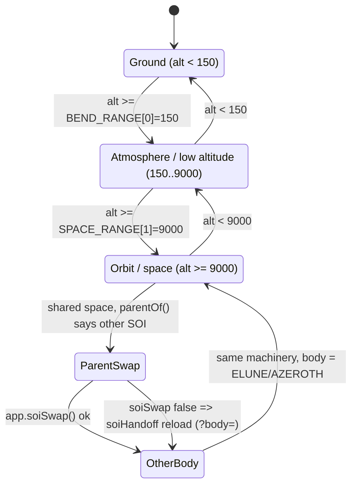
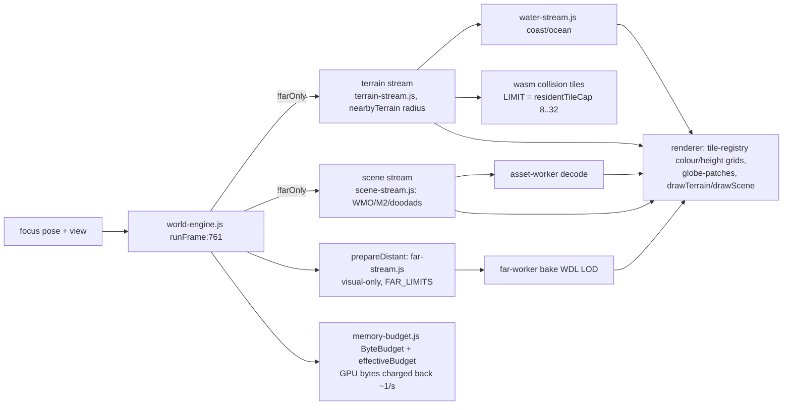
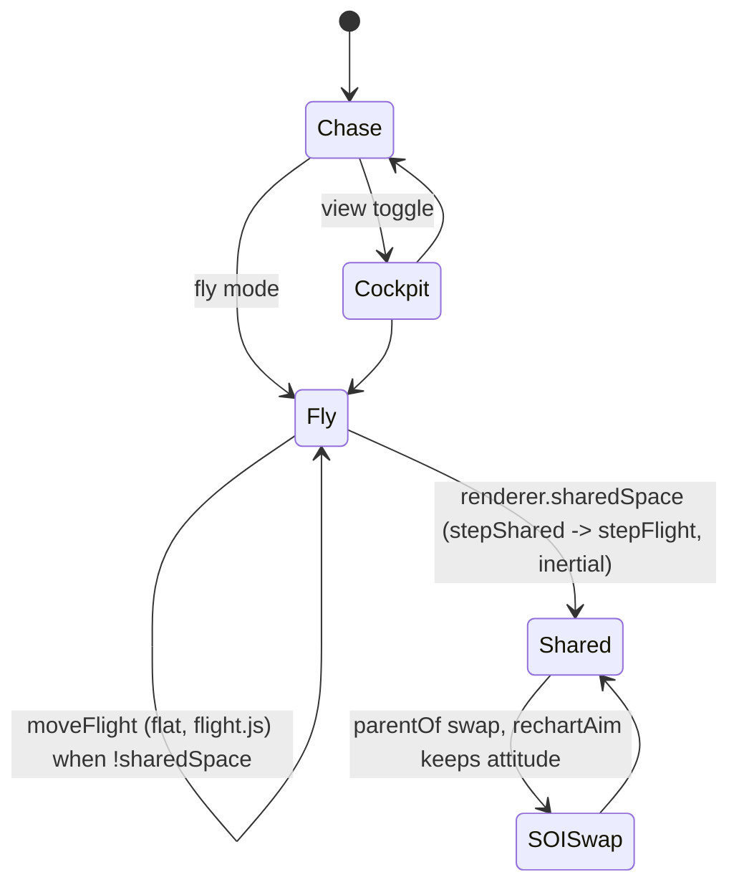

# System states: regimes, chunk loading, render transitions, camera

Read from `origin/main` **e0a19776** (docs only, no code changed). Line numbers refer to that commit; the Elune session is editing soi-swap/camera/renderer files, so re-check pointers before acting on them. Companion docs: `far-to-near.md`, `orbital-camera-controls.md`, `depth-culling.md`, `memory-budget.md`, `workers.md`, `clouds.md`, `elune.md`.

## 1. World / body regimes

One scalar, altitude above sea (yd), drives everything on a body. `regime.js:5` `regimeOf` tags it, `terrain-transition.js:24` `planetFactors` turns it into smooth 0..1 ramps.



Ramps are not regimes; they overlap (all `smoothstep`, `terrain-transition.js:4-8`):

| ramp | range (yd) | meaning |
|---|---|---|
| zone | 300 .. cloud base | zone sky/fog weight fades to the global look |
| bend | 150 .. 1500 | terrain curves onto the globe (`bend()` in vertex shaders) |
| globe | 0 .. 60 (`GLOBE_RANGE`) | analytic sphere pass fades in behind terrain |
| space | 2000 .. 9000 | sky thins to black, stars/sun/moons appear |
| cloud radius | = bend range | cloud shell radius scale (ground x12 -> true) |

Parent swap (shared space, `?bodies`): `bodies.js:109 parentOf` with hysteresis (`SOI_ENTER=.9`, `SOI_EXIT=1.1` of `soi=a*(mu_e/mu_a)^0.4`); refused below the parent's `ranges.space[1]`. Driven from `app-frame.js:56`; `app-loading.js:213 soiSwap` swaps near/far-only engines, `renderer-init.js:177 useBody` swaps radius-baked pipelines, `renderer.reset()/configure()` rebinds the chart. Fallback `world-app.js:106 soiHandoff` reloads with `?body=`.

## 2. Chunk loading pipeline



| layer | state | trigger / threshold | code |
|---|---|---|---|
| far bake | WDL/minimap horizon, visual only, never collision-ready | always (also on `farOnly` engines); `distantTiles` 24 (ceiling 96) | `far-stream.js:11`, `far-channel.js`, `far-worker.js`, `renderer-sky.js:28 horizonColour` |
| mid | globe patches (lat/lon quadtree) with colour/height grids | `globe>0 && settings.globeMesh`, altitude-driven split, `MAX_LEVEL 9`, `MAX_PATCHES 768` | `globe-patches.js`, `renderer-sky.js:68 drawPatches` |
| near tiles | terrain textures + collision tiles | within `nearRadiusNow` (850 yd at 8 tiles, grows with budget); cap `residentTileCap(budget)` 8..32 | `world-engine.js:41,211`, `memory-budget.js:133-140`, `terrain-stream.js` |
| scene/doodads | WMO/M2 instances | `SCENE_LIMITS.radius 850`, `distantRadius 6000`, `nearTiles` follows LIMIT; collision readiness wait (`objectWait`) holds physics | `scene-stream.js:8`, `world-engine.js:404-439` |
| water | coast water, deep-ocean backing | with terrain tiles; `COAST_GPU_LIMIT 64 MiB` | `water-stream.js:2,99` |
| budgets | total by setting/deviceMemory; shares scene .4 / far .15 / terrain .2; evict farthest-first to 90%, pinned near | floor 192 MiB, cap 3 GiB, fallback 384 MiB | `memory-budget.js:3-26`, `world-engine.js:31-44` |

Engine roles: the near engine (`client`) runs terrain+scene+physics; others (`app-loading.js:205`) are `farOnly=true` (only far scenes; `runFrame:768,770` skip terrain/scene). `soiSwap` flips roles, no reload.

## 3. Render transition stack (per frame, `world-renderer.js:106 draw`)

```mermaid
flowchart TB
  A[pf = planetFactors/FactorsFor alt :126] --> M[main pass clear sky colour :238]
  M --> S1[sky gradient + dome  (game zone sky only)]
  S1 --> G{pf.globe>0}
  G --> P[drawPlanet: analytic sphere, space.js spaceShaderFor<br/>patches if globeMesh; body slots via viewFrom]
  P --> TS[drawTerrain + drawScene (bend() in vertex shaders, k=pf.bend)]
  TS --> L[drawLights night side]
  L --> SH[shadow pass (ground only)]
  SH --> C[clouds pass: curved shell, reads depth]
  C --> PR[props pass (race props)]
  PR --> FX[fx pass: particles, read-only depth]
```

Depth state per pass: `render-passes.js` table (terrain/splat/scene less-write; particles no-write; sky/dome no-write; space always; patch less-equal; `depth24plus`). Other bodies: `body-render.js:13 bodyDrawList` (impostor below angular radius .004, else patches), `depthLayers` splits near/far when ratio > 1e7 (prototype only, `depth-proto-math.js`).

## 4. Camera navigation



* `world-camera.js:33 cameraView` picks fly | cockpit | chase; near plane `max(.1,min(100,|alt|*.01))` in fly.
* Floors: chase soft floor (`world-camera.js:28 lifted`, `:100-104`) uses `rig.cameraFloor` set from `camera-collision.js floorY` (max of sea+.5, terrain+.5); inertial flight `space-flight.js:37 clampSurface` (alt >= 2 over every body); `flight.js:20` hard `floor -10000`/`ceiling 1e6`; `clipCamera` BVH for chase/cockpit.
* Attitude: **quaternion** `[x,y,z,w]` in fly (`orient.js`, `stepOrient:37` blending to level via `ORIENT.levelAlt [800,4000]`); pose is `[x,y,z,yaw,pitch,qx,qy,qz,qw]`; `app-frame.js:41-55` rebuilds q from Euler if they disagree, steps, writes Euler back (`toEuler`, `orient.js:33`). **Euler** in chase (`rig.chase`, `PITCH_LIMIT` 89 deg), cockpit look, vehicle state `[3]` yaw/`[4]` bank, `flight.js:28` fallback, `elune-pose.js:10`, saved poses.

## 5. What code is active in each state

| state | transitions | streaming | render | camera/physics |
|---|---|---|---|---|
| Ground (<150) | none (`bend=0`) | near terrain/scene/water, collision tiles, physics held until required tiles ready | terrain, scene, shadows, zone sky, clouds shell (ground-scaled radius) | chase/cockpit, Euler, wasm physics (`world.tick`) |
| Low alt (150-1500) | bend ramps, zone fades, cloud radius ramp | same + far horizon | terrain bend in VS, globe fades in | fly (quaternion) or chase; `lifted` floor |
| Space ramp (1500-9000) | bend=1, globe=1, space ramp | far bake + patches (mid) | analytic sphere, patches, lights (>2500), stars | fly, `moveFlight` / `stepShared`, `ORIENT.levelAlt` |
| Orbit (>=9000) | space=1 | far only matters; near stream stays at focus | sphere + moon slots (`viewFrom`), no zone sky | inertial `stepFlight`, `clampSurface`, `parentOf` |
| Parent swap | one-frame rebind | roles flip near<->farOnly, `rebind` | `useBody` pipelines, reset/configure | `rechartAim` keeps attitude, chart unwrapped |
| Other body (Elune) | airless ranges (`rangesFor` scaled by sqrt R) | `version===4` manifest, `moon-source.js` | `AIRLESS_SURFACE`, no zone sky | `planet-physics` lunar gravity |

## 6. Duplication / complexity audit

| # | duplicated math | sites | unify into | risk |
|---|---|---|---|---|
| 1 | Regime + ramp tables per body | `regime.js:5` vs `bodies.js:45 regimeOf`; `terrain-transition.js:24 planetFactors` vs `bodies.js:47 planetFactorsFor`; `bodies.js:17 rangesFor/scaleRange` | Azeroth is one `BODIES` entry; delete the Azeroth-specific copies and call `*For(AZEROTH,...)` | Low-med: the v4 branch at `world-renderer.js:126` picks ELUNE; needs byte-identical Azeroth outputs (existing tests) |
| 2 | smoothstep | `terrain-transition.js:10`, `bodies.js:43`, `orient.js:6`, `space-flight.js:12`, `flight.js:23` | one `math.js` export | Trivial |
| 3 | Gravity/density/circular speed | `planet-physics.js:10-14` vs `bodies.js:52-57`; `ATMOSPHERE_EDGE`, `SCALE_HEIGHT=edge/7` in both | `planet-physics` takes a body, `bodies.js` re-exports | Low (pure, tested); `world-audio` uses `densityAt` |
| 4 | Equirect lat/lon <-> flat | JS: `space.js:26-39 planetFrame/subPoint/globeToFlat`, `planet-frame.js:7-16`, `bendRel` `space.js:100`, `cloud-march.js:93 worldAt`; WGSL: `bendShaderFor` `space.js:109`, `surface()` `:179-181`, lights `:264`, `clouds.js:77-92 worldAt`, patch shader | One `equirect.js` (JS) plus one WGSL snippet generator `equirectWgsl(radius,centre)` injected into all shaders | Med: shader precision (f32 near camera uses differences); tests mirror JS vs WGSL numerically today |
| 5 | Bend / curvature | WGSL `bend` (`space.js:109`) vs JS `bendRel` (`:100`) vs cloud `worldAt` both sides, `shellBendFromCurvature` | Generate JS mirror and WGSL from one description; keep golden-value tests | Med |
| 6 | Radius baked per body in shader factories | `body-shaders.js:13 shaderSetFor`, `bendShaderFor/spaceShaderFor/patchShaderFor` vs Azeroth consts (`bendShader`, `spaceShader`, `PLANET_RADIUS`, `WORLD_CENTRE` imported by `clouds.js`, `renderer-sky.js:30,32`) | Make radius/centre a uniform (or always go through the body factory); remove Azeroth singleton exports | Med-high: pipelines are rebuilt per body today; uniform path costs a few ALU ops |
| 7 | Chart <-> planet <-> inertial | `planet-frame.js` (`toPlanet/fromPlanet`) vs `bodies.js:90 toInertial/:95 fromInertial`; `shared-flight.js:8-23` finite-difference Jacobians (`inertialDir`, `chartJacobian`, `rechartAim`); `space.js planetFrame` | Analytic chart frame (east/up/south) shared by all; Jacobian from the analytic frame instead of finite differences | Med: swap continuity is tested only on poses |
| 8 | Longitude unwrap/wrap | `planet-frame.js:15-16`, `space.js:40 wrapFlat` (+ `poleFlip`), `shared-flight.js:40`, `world-camera.js:2 wrap`, `globe-patches.js:39`, `space.js:56 wrapDelta` (Azeroth-only) | One `wrapAngle/unwrapNear/wrapChart(body)` | Low-med; `wrapDelta` ignores body radius (bug-prone) |
| 9 | Camera floor / clamp | `camera-collision.js floorY`, `world-camera.js:28 lifted` + `:100-104`, `space-flight.js:37`, `flight.js:20` | Single `floorAt(body,pos)` returning a floor, applied once per camera mode | Med: three coordinate frames |
| 10 | Euler vs quaternion | `orient.js` q vs Euler in chase/cockpit/vehicle/`flight.js:28`/`app-frame.js:41-55` write-back/`elune-pose.js:10` | Quaternion canonical for fly/space; Euler only at vehicle/chase edges via `toEuler` | High: save format, chase pitch limits, `poleFlip`; do last |
| 11 | Flight speed laws | `FLY` (`space-flight.js:5`) vs `FLIGHT` (`flight.js:20`), both walk/fast 1200/8000 with different laws (`max(floor,K*alt)` vs log-smoothstep) | One speed law + per-regime tuning table | Low-med, but a behaviour change (flag it) |

### Ranked proposals

1. **#2, #3, #1** (pure, low risk, big clarity win: Azeroth becomes just a body).
2. **#8, #4 JS side** (one equirect/wrap module; mostly import changes).
3. **#9** floor policy (visible bugs historically: underground/underwater camera).
4. **#7** analytic frame replacing finite-difference Jacobians.
5. **#4/#5 WGSL generation** with numeric JS-vs-WGSL tests as the safety net.
6. **#6** radius-as-uniform (only if per-body pipeline rebuild cost matters).
7. **#11**, then **#10** (behaviour/format risk).

Complexity notes: `version===4` is a body test spread over `renderer-sky.js` (6), `renderer-events.js` (2), `world-renderer.js` (2); replace with `activeBody()` lookups. `planet-physics.js:2` still says "not yet driving flight" though audio reads it.
